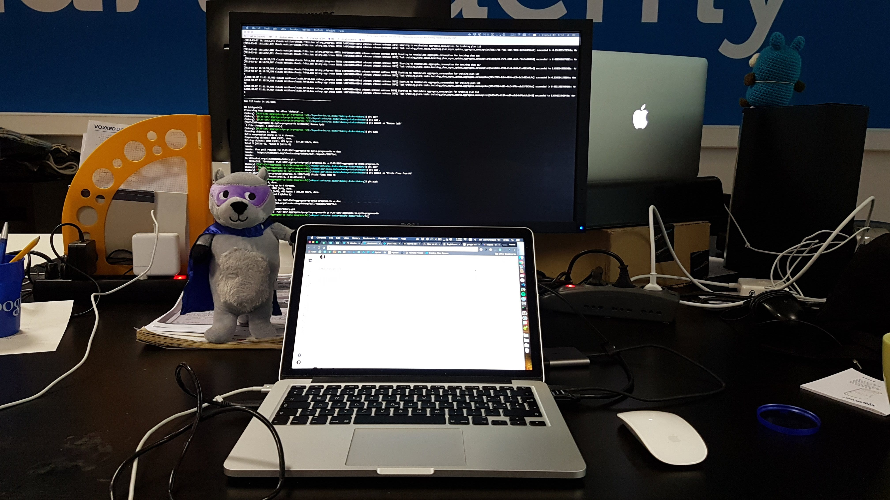
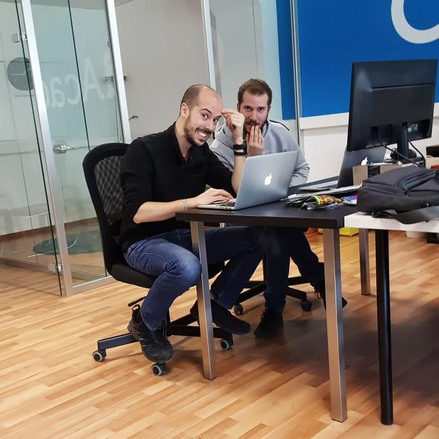
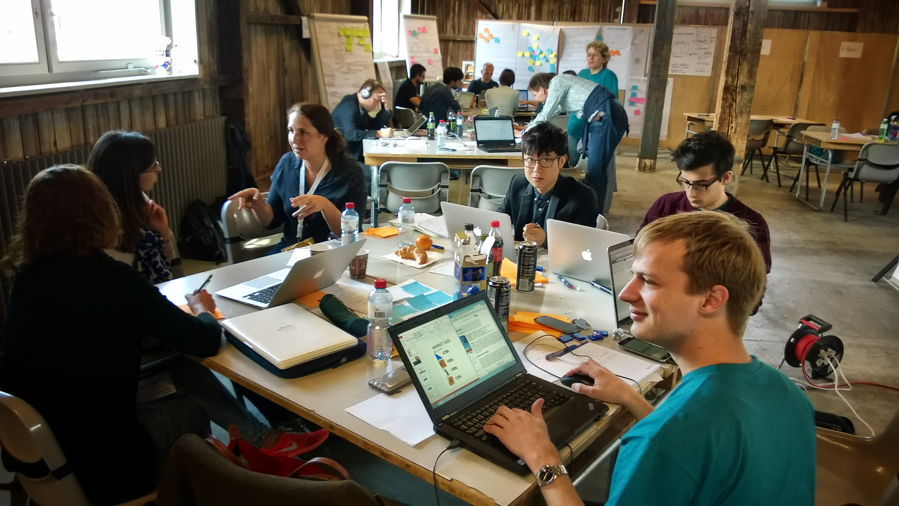

I've been working in startups for almost 4 years now. I'm convinced that a startup is a great choice for a student fresh out of university, because they are very dynamic environments: given their unstable nature you are "forced" to adapt, you learn something new every day and so it's a great opportunity to grow personally together with the company.

Since I'm now changing work environment, it's time to sum up. In this post I'll tell you what I learned working in startups, in my case [wavein.ch](http://wavein.ch/) and [Cloud Academy](https://cloudacademy.com).

## Your boss wants solutions, not problems

In startups, your superiors are often the same people who wrote the code before you, so the temptation to ask them for help is very high. But remember that their role has changed now, so they have a thousand other things on their minds. In fact they rely on you to complete the task you've been assigned. **Instead of asking for help, you need to ask them what decision to make**. The correct flow is that they ask you to do X, you analyze the problem and bring solutions with the pros and cons of each one, and finally the superior decides which solution to pursue and takes responsibility for it. This way everyone is happy: you know exactly what to do, the superior has spent little time and received only the information they cared about.

## Keep track of what you're doing

**Transparency in startups is essential**: you obviously know very well what you're working on, which bug is driving you crazy... But all this isn't so obvious to the rest of the world. I used [YouTrack](https://www.jetbrains.com/youtrack/) and [Jira](https://www.atlassian.com/software/jira) as [issue tracking systems](https://en.wikipedia.org/wiki/Issue_tracking_system); there's nothing worse than having fiery days at work and an empty board. This can be a problem for you because you're unable to show others what you're working on, but above all it's a problem for the Product Manager who will never be able to schedule work correctly, won't have any visibility on possible delays and finally can't prioritize work correctly. The same goes for blocked tasks: **always put in writing what you're working on**.

## Each of us is different

We have a character, our own personality: for this reason we often behave the same way with everyone. But we forget that others are all different too: there are those who are more outgoing, those who get offended easily, those who are shy, those who get angry over nothing, etc. **We can't behave the same way with everyone indiscriminately**. And worse still **we can't expect others to adapt to our character**, it will never work!

In my opinion it's our job to bring out the best in everyone by leveraging each person's qualities:

- *The person loves helping others*: let them help you! They can surely always teach you something.
- *They get offended easily*: try not to make useless jokes, keep a more professional / detached profile.
- *The person gets fired up easily and hates "being wrong"*: if you already have the solution to a problem in mind and just want confirmation, don't explain the macro problem to them right away. Otherwise they'll give you their solution and won't want to discuss it anymore. Instead try to break it down into small problems where the solutions are obvious and are the ones you adopted. Finally all these solutions will lead to your definitive solution by logical consequence.

  If this person starts to heat up, don't start mimicking their tone... Otherwise it's just an escalation of tones that will only end badly. Don't be afraid to interrupt the discussion without a solution if you see it's going nowhere.
- *They love making dirty jokes and like to "friendly insult" others*: play along! Don't take yourself too seriously. Very often if they openly make fun of you it's just because they want to have a laugh with you. If you're not used to it, it's really hard to digest at first, but then you stop noticing and actually enjoy it. In the end you understand when someone does it just for fun or because they hold a grudge against you.
- *You don't particularly like a person*: the worst thing you can do is burn all bridges around them. You have to spend your daily life with them and so it doesn't help anyone. Instead try to avoid the behavior that bothers them if someone tells you about it. Otherwise try to always behave well with them: help them and don't stick too close, so that slowly they'll understand they shouldn't have anything against you. If it doesn't work... Well, so be it; always try not to give them good reasons to hate you, it's the only thing you can do in these cases.
- *They're shy*: they'll never come to ask you for help or advice. Every now and then reach out, so that they open up too. This way you can both work.
- *They're a buck-passer*: "Sorry, could you do this for me? I know you worked on it recently.", "I know nothing about this stuff, can you do it since I know you know about it?". Helping is one thing, doing other people's work for them is another. You have your own goals too, try to stay focused on yours.

In short, these are just small examples and behaving differently with different people doesn't mean being fake. In my opinion it's the only way to live peacefully with many people in your working daily life.

## It's okay to say No

*Work is like water: it flows where it's done*. So you have to be careful about saying too many yeses, otherwise all the work ends up on you and then you have two very serious problems: you risk burnout because you don't have a moment to breathe, and on top of that they accuse you of being the bottleneck! It's important to help others, to do extra work, but it's more important to finish your assigned tasks. For the company it's important to respect its plan; if you fail to meet the original timelines, all this will have repercussions on the planning and this will have a negative repercussion on the whole company. The fewer people there are, the more visible the consequences. So **you shouldn't be afraid to say 'No'** to those who ask you to do more extra work. First do your own, then, if there's time left, accept extra work.
Other important 'No's are the technical ones. It's not rare for tasks to come down from above that, from a technical or usability point of view, make no sense at all. In these cases **it's our duty to say 'No' and give our reasons**: it's the developer who can understand the consequences of exotic requirements (technical debt, murky logic from the start, excessive UX complexity, etc.).

## A failure is truly a failure only if you learn nothing from it

Now I'll say something nobody likes to hear. Everyone fails at something: I've made mistakes and I'll make more, it's impossible to do everything perfectly in your career. Be wary of those who tell you "I've never made mistakes / I've never failed / Honestly I don't remember any mistakes I made in the past". They're just making fun of you or lying to themselves, because we, especially Italians, hate failing and above all hate admitting it.

But **making mistakes is an integral part of learning**. Experience is nothing more than a collection of mistakes you've taken home and are ready not to repeat. That's why those who say they've never made mistakes are lying; it means they've either never done anything or never had a truly challenging task.

**The sooner you recognize a mistake, the sooner you can fix it**. The sooner you fix it, the less damage you do. If a path is leading nowhere, or is becoming harder than expected, stop... Take a deep breath, analyze the situation and see if it's worth continuing. Otherwise it's time to ask a colleague for an opinion and then announce the problem to your superior (possibly with some solutions in hand). Then you make the necessary corrections.

You'll see that by doing so nobody can tell you anything, they'll appreciate your ability to foresee even greater damage, you take note of what went wrong so as not to repeat the same mistake in the future and you carry on happy to have avoided a possible disaster.

The alternative to all this? Tell everyone everything is fine, keep going your own way, try to make the best of a bad situation, buy time to try to keep something that's dead alive, buy more time, despair, throw in the towel and say you're working on something stupid that can't work, blaming the cleaning lady just to avoid taking responsibility... Nobody will appreciate it; on the contrary they'll understand they can't rely on you, so avoid it.

Failing isn't nice, but it happens. So if it has to happen, let it happen as soon as possible.

## Asking for help is a weapon, not a weakness

Unfortunately for many, asking for help is almost a personal defeat, while others don't do it to avoid taking up too much time of the person who makes themselves available to help. But **asking for a hand** from those who know more about a certain product, piece of code or technology is essential:

- **You reach the goal sooner**. Asking a question and getting an answer takes a few minutes. Trying to understand a piece of code written by others, looking for an answer online for a very specific case takes hours.
- **You really understand how the platform works**. Unfortunately in startups documentation leaves something to be desired, so very often you end up reading the code directly. Some parts can be obscure to understand simply because the real reason isn't made explicit. It's not rare to find horrible hacks in the middle of the code to solve specific cases that only one person knows about... And that person may no longer be at the company! If they're there, I recommend one thing: go ask.
- **You avoid writing blunders**: I've seen people who, just to avoid asking or understanding how a part of the product works, completely "bypassed" that part by writing a very similar one. This is evil, because you create two pieces of code that coexist, it's not clear why, and of course it makes the code unmaintainable. Or others who solved a problem only on the surface because "hey, I don't touch code written by others!"... This too is absolute evil: this way you can destroy the architecture in a few weeks. Rather, ask whoever wrote the code and then solve it.
- **You learn faster!** Even from a personal point of view it's much better to ask for help: you learn much faster and hearing how other developers reason is the best way to improve yourself...
- You need help too... What? You're thinking you're the best and you have nothing to learn, especially from your colleagues? Well, everyone who thinks that way is the one who grows the least and falls behind, because they think they have nothing left to learn and stay stuck with their knowledge. Literally anyone can teach us something, even the most junior person in the company, because simply every person has their own, unique, personal background.

## Nobody cares about perfect code

Here's a lesson that can hurt those who come fresh out of university. In the academic world the most important thing is writing perfect code, having the most abstract code possible so that it easily adapts to any use case. Nobody looks at your code until the final exam and so you can work in complete tranquility. There's just one small detail... In the university world you have a lot of time available, in startups you don't. The feature you've been asked for is blocking other developers, stakeholders want your part ready and deployed yesterday. So **it's not the goodness of your code that's evaluated, but your execution**. The speed with which you complete your task.

So how do you make good code coexist with execution speed? Through **iterations**: write the bare minimum to reach the goal, don't complicate things with strange constructs. Writing the bare minimum is very different from writing bad code: keep following best practices, keep the code as clean as possible, keep evaluating that the more shortcuts you take the more maintainability you have to sacrifice. But don't worry about the problem before it happens, because maybe that problem will never come... And if it ever does, you iterate, but at least your original feature is already on the market and can be validated by the customer.

## Reach your goals, period

Another lesson I learned the hard way, and that I received like a spinning kick to the gums. As soon as I joined Cloud Academy everything was a new world, I was eager to do things and I was really fired up. One of the first tasks assigned to me was automating the generation of static files on the frontend. While doing it I had the brilliant idea of also making an extra improvement that unfortunately I don't remember now. I went to my superior to show him my progress: after telling him where I had got to, I also explained my improvement and what we could do more thanks to it. While I was explaining he abruptly interrupted me with a "Why the hell should I care?"... Total embarrassment, 5 seconds of silence... All I managed to say was an "Ah...".

I was used to [wavein.ch](http://wavein.ch/) having much more room to maneuver, but simply because we were smaller and I was almost my own boss. So everything I did, good or bad, went in the direction I deemed right. But in a startup you have "well-defined" tasks. If you have assigned tasks you have to do those and do the minimum to reach that goal. Everything else isn't looked upon favorably, it's seen as wasted time. Remember that **time is the scarcest resource in a startup**. So be careful with unrequested features; even if they may be a great improvement for you, others might not care "one damn bit".

## A startup is not a family

A startup is not a family. You need to keep that well in mind. We like **meritocracy**, we want it everywhere, but we must also be able to accept the flip side of the coin.

Now I'll explain what a working relationship is for me, in the most meritocratic and cynical version possible: I get paid to offer a certain service to the company. Through my service, the company acquires value. If the value generated by my service is higher than my salary, the company has every interest in keeping me. The higher this delta is, the more the company "loves me"; if this delta is too marked I can ask for a raise and the company should recognize it. If it doesn't give it to me, I have every right to look around to see if someone else recognizes my value.
If instead the delta is negative it means the company no longer benefits from paying me and so it has every right to let me go. Finally there's one last option: the company no longer has funds, so it starts laying off the people with a less marked delta, that is, those who generate less value for the company.

Using this clean, meritocratic, cynical-as-you-want version, you can't remain "burned" by a possible layoff. These are purely logical and rational things.

But we're not machines and so there are a lot of other variables at play that can deeply affect people's sensitivity: the whole delta story is fine, but is it better to lay off a young person with no dependent children or lay off a person with a family and 3 children even if they generate less value for the company? Is it better to keep working for the company I work for even if they pay me little, where I've made a lot of friends and I feel good, or change jobs and go where they pay me more?

I've met people who experienced a layoff very badly because they felt "betrayed" by the company. But in my opinion there's little to get angry about: nobody likes laying people off, and the choice of who to lay off is something I think would distress anyone.

I experienced first-hand what it means to be laid off from one day to the next. Nevertheless I remained on excellent terms with those who laid me off because, being in a startup, I knew very well that money doesn't grow on trees: I understood the real reasons and so I was able to effectively separate the **working relationship from friendship**. **They are two things that coexist together, but they certainly aren't the same thing**.

With this I'm not saying you can't make friends at work. On the contrary, at work you meet wonderful people and friendships are born that last for years even outside work. I'm just saying that **I don't have a job because I'm friends with someone, but because I'm generating value for the company** and it is able to recognize this generated value. If you keep this aspect in mind, in my opinion it's easier to accept a layoff.

## Don't exasperate the work environment

"Is it possible, Natali, that you never get angry?". Actually I get angry too, but I simply try not to show it. We spend a good part of the day at work and so it's important that we keep the environment as calm as possible, even if anger is always around the corner. Over these years I've fundamentally learned these two things:

- **Getting angry is useless**. Unfortunately it happens to see people who claim to be right simply by shouting or visibly showing irritation. The important thing is to stay calm anyway, wait a few seconds before answering and, if the situation really doesn't calm down, it's better to end the conversation and postpone it when the tones are calmer... Also because the problem isn't solved in these situations.
- **You get nothing with force**: nobody will do you a favor/task under duress, you have to motivate people, not force them. I've been lucky enough to see three types of leadership: those who force you, those who "threaten" you and those who instead motivate you to do things. The best results of course are obtained with the last one. Exasperating the work environment to get something is never a solution; maybe it can work in the short term, but in the long term it can only give rise to a much more serious problem: sending [turnover](https://en.wikipedia.org/wiki/Turnover_(employment)) through the roof. The problem is that forcing or threatening a person is simple, motivating is not at all. And that's why it's important to choose the various leaders in the company well... Not everyone is able to do it.

## Personal training is essential

Did you think that once you finished your studies you could say goodbye to studying? Well, in IT it's only the beginning! **IT is a continuous evolution; if you stand still even for just two years you're automatically cut out**. For many this is a condemnation, but for me it's the most interesting part of the job. You never stop learning and you can tangibly see a continuous evolution in your work and in yourself... Repetitive work ends up being boring!
To train yourself there's only the embarrassment of choice: from e-learning platforms, small projects, to meetups organized by passionate people who really put their soul into what they do.

## Conclusions

I hope this post can be helpful to those who are afraid to start a working career, especially in a startup. It's certainly a good gym to learn quickly, but I'm sure it can be a bit scary for those who have never worked in one.

If you're young I can't recommend anything other than working in these environments: you have fun, you meet truly wonderful people who share your same passion and you're never bored!

See you next time!
