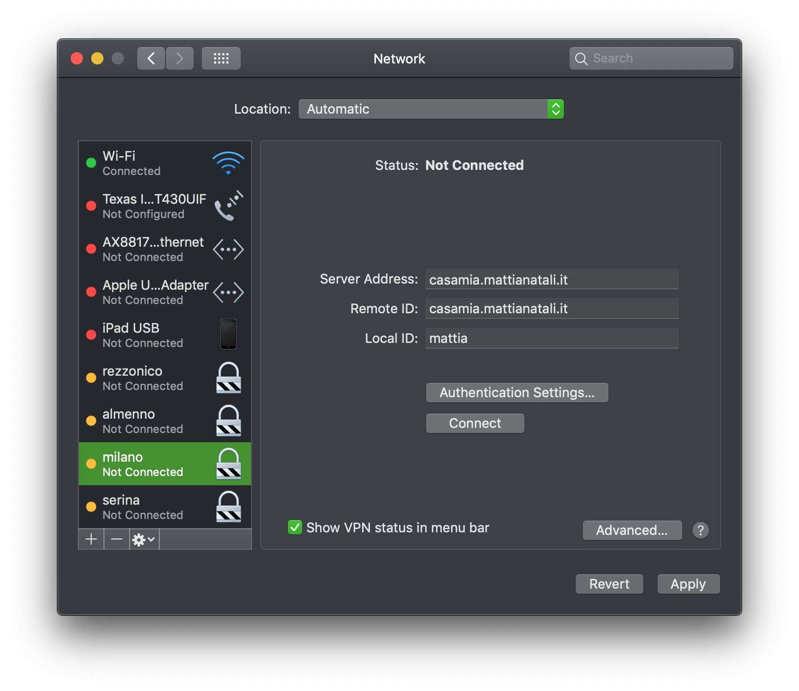

## Introduction

You're at work and you've been tasked with configuring 20 virtual machines all the same way? You're at home and your Raspberry Pi unfortunately corrupted the SD card and so you have to reconfigure it for the umpteenth time? Then **Ansible could solve many of your problems**!

If you're like me I'm sure you don't like spending the day performing repetitive tasks that give practically zero added value to yourself: **performing repetitive tasks isn't a job for us humans**, we can easily delegate it to machines so we can dedicate ourselves to things that really matter.

How do we automate these tasks? A certainly effective answer is [Ansible](https://www.ansible.com/), the configuration tool I prefer.

## Goal

If you've read the [official Ansible documentation](https://docs.ansible.com/ansible/latest/user_guide/quickstart.html), I'm sure you've noticed that it's as boring as the tool itself is powerful. It's easy to fall asleep reading it even before understanding Ansible's real potential.

That's why I decided to write this mini guide hoping it's a bit more effective. I hope to achieve this goal through a concrete example that happened to me and that I still use: **we're going to configure a [VPN Server](https://en.wikipedia.org/wiki/Virtual_private_network) on a [Raspberry Pi](https://www.raspberrypi.org/)**.

Thanks to this Ansible playbook, we can create a VPN Server on a Raspberry Pi by running a single command `ansible-playbook -vv -i hosts vpn.yml`. **The functions it performs behind the scenes are many**:

- It downloads the certificate via https://letsencrypt.org/ for the domain pointing to our home, for example `myhome.mattianatali.it`.
- It sets up automatic renewal of the certificate itself.
- It opens the correct ports on the Raspberry Pi to make the VPN work.
- It installs all the libraries and applications needed to install the VPN Server.
- It correctly configures the settings we decide for the VPN, for example the user to access it.
- It sets up automatic certificate updates based on the renewal of the Let's Encrypt certificate.

Now imagine if we didn't have Ansible doing all these things with one command. Surely 2 days after running these commands manually I would have already forgotten everything, not to mention the number of attempts I would have had to make even the second time to reconfigure everything from scratch.
Precisely for this reason, once I understood how I could do it, I created the Ansible script. **Now I have the versioned, ready-to-use playbook in a [public repository](https://github.com/matitalatina/vpn-raspberry-ansible/)**.

In this guide we won't dwell too much on the details of the VPN: **we're more interested in the reasoning that led to this result and which Ansible features we used**. Creating the VPN is just a concrete example that covers many Ansible features.

## Requirements

The requirements to follow this guide are the following:

- We have a minimum knowledge of Linux. The commands `sudo`, `apt-get install`, `cd`, `chmod`, `ssh` should be familiar to us.
- [We've installed Ansible on your laptop](https://docs.ansible.com/ansible/latest/installation_guide/intro_installation.html).
- [Our Raspberry Pi must have SSH enabled](https://www.raspberrypi.org/documentation/remote-access/ssh/).

## Glossary

The first obstacle you encounter with Ansible is learning and remembering the various terms it uses. Here's a small summary that will help us throughout the guide:

- *Modules*: modules are small programs that Ansible offers us to complete tasks. For example: we want to install a package like vim? We can use the [apt](https://docs.ansible.com/ansible/latest/modules/apt_module.html) module; we want to add a cronjob? There's the [cron](https://docs.ansible.com/ansible/latest/modules/cron_module.html) module. [There really are an infinite number of them](https://docs.ansible.com/ansible/latest/modules/modules_by_category.html).
- *Task*: for example a task is "install the nginx program". We can see them as the smallest unit we have in Ansible; basically it's calling a module with the various parameters. An example of a task is the following
  
  ```yml
  - name: Install nginx
      apt: 
        name:
          - nginx
  ```
  
- *Role*: Ansible explains the role using a football metaphor. An example of a role could be "striker", "defender", "midfielder". In our example we have two roles: "certificate installer", "VPN installer". In short it's a set of tasks that have a very specific function, a role indeed.
- *Playbook*: it's the largest unit we have in Ansible. A playbook organizes the various roles to complete our task. For example in our case it's the set of the two roles explained above. [My repository about creating the VPN](https://github.com/matitalatina/vpn-raspberry-ansible/) is indeed a playbook. In our case we'll have a playbook that will carry out our task, that is, installing the VPN with the various certificates.
- *Inventory*: it's a file that contains groups that in turn contain machines. These machines are the ones that will be affected by our playbook. Ansible is very powerful; with a single command you can install the VPN on 100 machines. We'll have a group called `vpns` that will have our target machine named `rpi` (the Raspberry Pi) defined inside it.

Now we have a common terminology; it's not necessary to understand everything now, surely it's all still very foggy. But later, after seeing a concrete example, everything will be clearer.

## Let's perform the task manually

Before automating we must be clear about what we have to do; the first time maybe we don't have clear ideas at all, we make many attempts and some will lead nowhere. **So the first thing to do is try manually** without bothering Ansible so as to be faster in the "construction" phase of the various tasks to reach the goal. In our case we first educate ourselves a bit about the VPN, read how [strongswan](https://www.strongswan.org/) works, which libraries it needs to work, how to configure it, etc. Then we educate ourselves about [Let's Encrypt](https://letsencrypt.org/) to issue a valid certificate for our domain `myhome.mattianatali.it` that points to our home, so as to have the access point to our VPN.

I'll spare you this whole phase; the thing we must keep in mind is this: **during the manual phase let's keep in mind every step we take to complete our task**, every single configuration file we modified, anything we must keep track of because soon we'll automate it.

## Let's define the roles

Once the goal is reached manually, it's time to organize our ideas. At the end of our analysis our Ansible playbook must perform the following tasks:

- It downloads the certificate via https://letsencrypt.org/ for the domain pointing to our home, for example `myhome.mattianatali.it`.
- It sets up automatic renewal of the certificate itself.
- It opens the correct ports on the Raspberry Pi to make the VPN work.
- It installs all the libraries and applications needed to install the VPN Server.
- It correctly configures the settings we decide for the VPN, for example the user to access it.
- It sets up automatic certificate updates based on the renewal of the Let's Encrypt certificate.

Of all these tasks **we can find two well-distinct roles** that can be separated.

- **The generation and maintenance of certificates** for `myhome.mattianatali.it` using Let's Encrypt.
- **Installation of the VPN** which uses the previously created certificates.

What advantages does separating the tasks found into these two roles bring?

- The more self-contained and specific the roles are, the simpler they are to maintain.
- The more self-contained they are, the easier they are to reuse for other playbooks.
- If the defined role is standard enough, it's likely someone has already implemented it!

In fact **Ansible has a site to search for these roles: it's called [Ansible Galaxy](https://galaxy.ansible.com/)**. Generating certificates via Let's Encrypt is a fairly standard thing, and indeed we're lucky! We have a role that already does what we need; [we can find it here](https://galaxy.ansible.com/geerlingguy/certbot); the best way to learn how to use it is anyway to look at [its repository on GitHub](https://github.com/geerlingguy/ansible-role-certbot).

To install the role, so we can use it shortly, let's type in the console:

```bash
ansible-galaxy install geerlingguy.certbot
```

Searching again on that site I didn't find a role that creates the VPN, so for that we have to fend for ourselves.

## Let's define the Playbook

We said that modules and tasks are the atomic part of Ansible; these are grouped into roles that perform a certain function (in our case there are two), **the entity that orchestrates these roles is the playbook**.
If we wanted to depict it in a diagram:

```yml
playbook
  roles
    tasks
```

**To create our VPN configuration we adopt a [top-down](https://en.wikipedia.org/wiki/Top-down_and_bottom-up_design) approach**. In other words we start working on the most "external" and general part of the problem, then go deeper and deeper into detail down to the various tasks. The part that contains all the others is the **playbook**.
Our playbook must start in sequence:

- The role that generates the certificates. Already implemented thanks to the library we found on [Ansible Galaxy](https://galaxy.ansible.com/)
- The role that installs the VPN. We must implement it.

Ansible relies heavily on conventions; let's start right away using the [best practices](https://docs.ansible.com/ansible/latest/user_guide/playbooks_best_practices.html) provided by Ansible.

We can use my repository with the finalized playbook as a reference. The structure to create our playbook is the following:

```yml
group_vars/
  vpns.yml           # All the group-level variables go here (our group is called vpns)
   
host_vars/
   rpi.yml           # Here we assign the variables for individual machines (our only machine is called rpi)

vpn.yml              # This is our playbook
hosts                # This is our inventory, we define the groups (vpns) and the machines (rpi) on which we want to run the playbook.

roles/               # This folder contains all the roles we'll define
    vpn-install/     # This folder contains our role to install the VPN.
      ...            # We'll see the subfolder structure later.
```

Let's start writing our playbook in the `vpn.yml` file

```yml
---
- name: Deploy IKEv2 Road Warrior VPN
  hosts: vpns

  roles:
    - role: geerlingguy.certbot
      become: yes
    - role: vpn-install
      become: yes
```

The format the file is written in is [YAML](https://en.wikipedia.org/wiki/YAML); it's a very readable format and is now a de facto standard in applications that cater to DevOps. [If you've never seen it I recommend reading this guide, which explains the format quickly](https://learnxinyminutes.com/docs/yaml/).

Our Playbook will have to do only one thing: create a VPN Server. In Ansible jargon, a playbook is made up of multiple **plays**. We have only one *play* in our playbook.

**How do you figure out how and when to create a play?** Usually if we have *multiple roles* that affect *a single group* of machines, then this is a good candidate to be a play. If instead we had *some roles* targeting the *Raspberry* and *other roles* that had to configure *routers*, then our playbook would be made up of two plays. Because one play worked on the Raspberry Pis, the other on the routers.

Let's explain the various commands inside a play:

- `name`: we can insert a short description of what our play will do.
- `hosts`: we define which group will be used as the target of our play. In our case it's the `vpn` group, which will contain our Raspberry Pi.
- `roles`: we define the roles in chronological order that will be started on our hosts.
- `role: geerlingguy.certbot`: the first role to start will be the one we found on [Ansible Galaxy](https://galaxy.ansible.com/); it will install and keep the certificates for the VPN up to date.
- `become: yes`: it means the script will be started enabling *privilege escalation*. In practice we'll start the role as root. Both the role to download the certificates and the VPN installation need to be started as root. So in both we'll put `become: yes`.
- `role: vpn-install`: we start the VPN installation after the certificates role. We still have to figure out how to define this role.

We've finished the playbook. In practice our playbook is saying this: "Install the certificates and then install the VPN on the machines that are part of the `vpns` group".

## Let's define the inventory

We said the playbook will work on the group of machines called `vpns`. But where is this group defined? This is where the **inventory** comes in. The inventory object is where we define the groups of machines and the machines that make up this group.
The file containing this inventory is the `hosts` file. The name is arbitrary; whatever name we give it will then have to be referenced when we invoke the command to start the playbook.

Our hosts file will have this content.

```ini
[vpns]
rpi
```

Simply with these two lines we're saying that the `vpns` group contains the `rpi` machine which is the name we're giving to our Raspberry Pi. It's easy to guess that if we had multiple Raspberry Pis, we could configure them at the same time by defining them in this file in the `vpns` group.

The inventory syntax is simple and it's this

```ini
[group1]
machine1
machine2

[group2]
machine3
machine4

...
```

## Let's define the group and host variables

We've defined the playbook that works on the `vpns` group, we've declared the `vpns` group saying that it contains our Raspberry Pi named `rpi` through the inventory. But **how does Ansible know how to connect to our Raspberry Pi?** How do we give it the IP, user, password to connect with SSH? How do we tell it which domain we want to get the certificates for? For now it only knows there's a machine called `rpi`.

All these things are **variables**; they vary based on the machine or group of machines we want to act on. Ansible has two folders dedicated to this purpose: a folder called `group_vars` will contain the variables that are common to all machines belonging to a group, the `host_vars` folder will contain all the variables specific to a single machine.

In our project we can insert these two folders; these folders will have YAML files named after our group in `group_vars` and named `rpi.yml` in `host_vars`.

So the structure of our folders, as far as variables are concerned, is the following:

```yml
group_vars/
  vpns.yml           # Contains all the variables common to all machines belonging to the vpns group
   
host_vars/
   rpi.yml           # Contains all the variables belonging to the rpi machine
```

Inside the `rpi.yml` file defined in the `host_vars` folder, Ansible will be able to find all the information it needs to complete the playbook. The `rpi.yml` file contains the following variables:

```yml
---
ansible_host: YOUR-SSH-HOST
ansible_user: pi
ansible_password: YOUR-SSH-PASSWORD
domain: myhome.mattianatali.it
# You can add more than one Road Warrior Client.
vpn_users:
  - username: CLIENT-WARRIOR-USERNAME
    password: CLIENT-WARRIOR-PASSWORD
# Change it if you want to restrict the local hosts the Road Warrior Client should see.
vpn_local_ts: "0.0.0.0/0"

# ansible-role-certbot variables
# More info here https://github.com/geerlingguy/ansible-role-certbot
certbot_auto_renew: true
certbot_create_if_missing: true
certbot_create_method: standalone
certbot_auto_renew_user: root
certbot_auto_renew_hour: 3
certbot_auto_renew_minute: 30
certbot_auto_renew_options: "--quiet --no-self-upgrade"
certbot_create_standalone_stop_services: []
certbot_certs:
  - email: YOUR-EMAIL-HERE
    domains:
      - "{{domain}}"
```

Through the `ansible_host`, `ansible_user`, `ansible_password` variables we can provide Ansible with all the information to connect to SSH, to run our playbook.
We can avoid inserting username and password by using the SSH configurations. [In this guide, in the SSH section, I explain how to do it](/en/how-to-be-productive-with-the-terminal/).

The following fields are the ones we'll use when we create the role to install the VPN. The `domain` field will contain the name of our domain that points to our home; in our case it's `myhome.mattianatali.it`. In `vpn_users` we define the username and password of the clients that can connect to our VPN. `vpn_local_ts` is a variable that allows us to limit access to clients connecting to the VPN; for example at my home I limited it to my subnet `192.168.1.0/24`.

All the variables starting with `certbot_` are part of the role we downloaded with Ansible Galaxy; they allow us to configure anything about certificate renewal for the `myhome.mattianatali.it` domain. Finding the variables that make up the role we downloaded is simple; [just read the documentation of the role we used](https://github.com/geerlingguy/ansible-role-certbot).

We can notice that the last line of our file has a particular variable `{{domain}}`. **The double braces allow us to reference another already-defined variable**. This way we can define only the `domain` variable in the fourth line, and automatically the `{{domain}}` variable will have the same value. This way we have ["a single source of truth"](https://en.wikipedia.org/wiki/Single_source_of_truth) and we avoid gross errors like updating only one variable and not the other.

To insert values in the double braces, Ansible uses a very famous template engine in Python: [Jinja2](https://docs.ansible.com/ansible/latest/user_guide/playbooks_templating.html). Jinja2 is very powerful; for now we just need to know that when we write `{{value}}` it means we're inserting the content of the variable we find in the braces.

## Let's implement the role to install the VPN

We've defined the playbook, the inventory, the variables and the role to install the certificates we found on Ansible Galaxy; now **we just need to implement the role that installs the VPN server on the Raspberry Pi**.

Roles are defined in the `roles/` folder; let's create a folder inside it that will take the name of the role (`vpn-install`), the same name we defined in the playbook in `vpn.yml`.
The structure of our folders will be defined like this:

```yml
...
roles/    
    vpn-install/
        files/        # Contains the files to copy to the Raspberry Pi
            ...
        tasks/        # Contains the instructions to execute
            ...
        templates/    # Contains the source templates to then upload to the Raspberry Pi
            ...      
```

In this case too [we're using Ansible's conventions](https://docs.ansible.com/ansible/latest/user_guide/playbooks_best_practices.html#directory-layout), we're not making anything up:

- *files*: contains all the files we need to upload to the Raspberry Pi.
- *tasks*: contains the tasks to execute on the Raspberry Pi to install the VPN.
- *templates*: it's similar to the files folder, but in this case we won't have the files to copy, but a template that we must render before we can copy it to the Raspberry Pi. Wait a moment and then its use will be clear.

### Let's define the tasks

**Now let's focus on the *tasks* folder**; as we said here we'll have all the commands to execute on the Raspberry Pi to install the VPN.
The first file Ansible looks for in the tasks folder is `main.yml`. In this file we write all the tasks.

**How do we know which tasks to execute?** Here we must retrieve the commands we executed manually at the beginning of the article. Once retrieved we must translate them into tasks, using the **modules** Ansible provides us.

These are the "commands" we need to translate into Ansible tasks; take them for granted, I don't want to bore you too much with the VPN question:

1. Install the following packages using `apt-get`: `strongswan`, `strongswan-swanctl`, `libstrongswan-standard-plugins`, `libstrongswan-extra-plugins`, `libcharon-extra-plugins`.
2. Enable [IP Forwarding](http://www.ducea.com/2006/08/01/how-to-enable-ip-forwarding-in-linux/).
3. Add the file with the VPN configuration in `/etc/swanctl/swanctl.conf`.
4. Add the file with the various Strongswan plugins in `/etc/strongswan.conf`.
5. Create the `x509`, `x509ca`, `private` folders in `/etc/swanctl/`; here we'll add the various certificates created by the previous role we found on Ansible Galaxy.
6. Copy the certificates created by the role that creates them from the `/etc/letsencrypt/live/myhome.mattianatali.it/` folder into the correct folders created in the previous point.
7. Add a script that repeats the previous point every time the certificates are renewed. [Let's Encrypt](https://letsencrypt.org/) certificates only last 3 months.
8. Add a [cronjob](https://en.wikipedia.org/wiki/Cron) that runs the previous point right after the certificates are generated.
9. Enable [IP Masquerading](https://en.wikipedia.org/wiki/Network_address_translation#IP_masquerading), changing the Raspberry Pi firewall rules.
10. Reboot the Raspberry Pi.

These are all the operations we need to automate to have our VPN working on the Raspberry Pi. **There are many operations, some complex, boring to do manually, the chance of error is high, the commands are practically impossible to remember by heart for a future configuration**. Maybe now you understand why I immediately thought of Ansible when I tackled this endeavor!

With Ansible we can do all this with a few lines of code and disarming clarity. The final result of our `main.yml` file, which includes all our commands, is the following. I added comments in the file so as to have the right correspondence with the points written just above:

```yml
---
# Install the following packages using `apt-get`: `strongswan`, `strongswan-swanctl`, `libstrongswan-standard-plugins`, `libstrongswan-extra-plugins`, `libcharon-extra-plugins`.
- name: Install strongswan dependencies
  apt: 
    name:
      - strongswan
      - strongswan-swanctl
      - libstrongswan-standard-plugins
      - libstrongswan-extra-plugins
      - libcharon-extra-plugins

# Enable IP Forwarding.
- name: Add Client Traffic Forwarding
  sysctl:
    name: "{{ item }}"
    value: 1
  with_items:
    - net.ipv4.ip_forward
    - net.ipv6.conf.all.forwarding

# Add the file with the VPN configuration in /etc/swanctl/swanctl.conf
- name: Add VPN configuration
  template:
    src: templates/swanctl.conf.j2
    dest: /etc/swanctl/swanctl.conf

# Add the file with the various Strongswan plugins in /etc/strongswan.conf
- name: Add strongswan.conf with correct plugins
  copy:
    src: files/strongswan.conf
    dest: /etc/strongswan.conf

# Create the x509, x509ca, private folders in /etc/swanctl/
- name: Create folders to store certificates
  file:
    path: /etc/swanctl/{{ item }}
    state: directory
    mode: 0755
  with_items:
    - x509
    - x509ca
    - private

# Copy the certificates created by the role that creates them from the /etc/letsencrypt/live/myhome.mattianatali.it/ folder into the correct folders created in the previous point
# Note the use of the domain variable to insert myhome.mattianatali.it
- name: Copy certificates from let's encrypt to strongswan
  shell: |      # In YAML "|" means "take everything I write after this as a variable and preserve line breaks"
    cp /etc/letsencrypt/live/{{ domain }}/chain.pem /etc/swanctl/x509ca/
    cp /etc/letsencrypt/live/{{ domain }}/privkey.pem /etc/swanctl/private/
    cp /etc/letsencrypt/live/{{ domain }}/fullchain.pem /etc/swanctl/x509/

# Add a script that repeats the previous point every time the certificates are renewed
- name: Add script to copy new certificate
  template:
    src: templates/renew-certs.sh.j2
    dest: /root/renew-certs.sh
    mode: u=rwx,g=r,o=r

# Add a cronjob that runs the previous point right after the certificates are generated
- name: Add cronjob to copy new certs
  cron:
    name: Copy certs to strongswan
    hour: "{{ certbot_auto_renew_hour }}"
    minute: "{{ certbot_auto_renew_minute + 15 }}"
    job: "/root/renew-certs.sh"

# Enable IP Masquerading]
- name: Add iptable rule permanently
  lineinfile:
    path: /etc/rc.local
    line: iptables -t nat -A POSTROUTING -o eth0 -j MASQUERADE
    insertbefore: ^exit 0

# Reboot the Raspberry Pi
- name: Finished! Rebooting the system...
  reboot:
```

We can immediately notice that **the tasks all have the following structure**

```yml
- name: TASK DESCRIPTION
  MODULE_NAME:
    OPTION_1: OPTION_1_VALUE
    OPTION_2: OPTION_2_VALUE
```

[The modules provided by Ansible are many](https://docs.ansible.com/ansible/latest/modules/modules_by_category.html).

The modules I used in this role are the following:

- [*apt*](https://docs.ansible.com/ansible/latest/modules/apt_module.html): to install the packages using the `apt-get` command.
- [*sysctl*](https://docs.ansible.com/ansible/latest/modules/sysctl_module.html): to modify the `sysctl.conf` file and therefore modify the system kernel attributes. In our case it was used to enable IP Forwarding.
- [*template*](https://docs.ansible.com/ansible/latest/modules/template_module.html): to process a file using the Jinja2 template engine, and copy the result to the Raspberry Pi. **We need Jinja2 to insert a file that's dynamic based on the host and group variables we're working on**.
- [*copy*](https://docs.ansible.com/ansible/latest/modules/copy_module.html): to copy a file from a local folder to our Raspberry Pi; in this case we don't need Jinja2 to insert variables.
- [*file*](https://docs.ansible.com/ansible/latest/modules/file_module.html): to work with files and folders on the Raspberry Pi, for example change permissions, create or delete folders, etc.
- [*shell*](https://docs.ansible.com/ansible/latest/modules/shell_module.html): to execute classic commands via the CLI on the target machine.
- [*cron*](https://docs.ansible.com/ansible/latest/modules/cron_module.html): to modify the [crontab](https://en.wikipedia.org/wiki/Cron) file on the machine.
- [*lineinfile*](https://docs.ansible.com/ansible/latest/modules/lineinfile_module.html): to verify that a specific line exists in a given file.
- [*reboot*]((https://docs.ansible.com/ansible/latest/modules/reboot_module.html)): to reboot the Raspberry Pi at the end of everything.

The options of the various modules are quite self-explanatory; in any case if any aren't clear you can read the documentation of the individual modules. The module names in the previous list all point to the reference guide.

There are some though that deserve a more in-depth description: for example the task

```yml
# Create the x509, x509ca, private folders in /etc/swanctl/
- name: Create folders to store certificates
  file:
    path: /etc/swanctl/{{ item }}
    state: directory
    mode: 0755
  with_items:
    - x509
    - x509ca
    - private
```

are three tasks in one; **thanks to `with_items` you can define a list of variables and then, through `{{ item }}`, it's possible to execute the module for each element in the list**. So in the previous case it's as if we had written:

```yml
# Create the x509, x509ca, private folders in /etc/swanctl/
- name: Create folder x509
  file:
    path: /etc/swanctl/x509
    state: directory
    mode: 0755
- name: Create folder x509ca
  file:
    path: /etc/swanctl/x509ca
    state: directory
    mode: 0755
- name: Create folder private
  file:
    path: /etc/swanctl/private
    state: directory
    mode: 0755
```

Seeing the `{{ item }}` tag we can guess that our `main.yml` file is processed with [Jinja2](https://jinja.palletsprojects.com/en/2.10.x/) before being executed. In fact **in our file to define the tasks we can refer to all the variables of the previously declared hosts and groups**. For example the task:

```yml
- name: Add cronjob to copy new certs
  cron:
    name: Copy certs to strongswan
    hour: "{{ certbot_auto_renew_hour }}"
    minute: "{{ certbot_auto_renew_minute + 15 }}"
    job: "/root/renew-certs.sh"
```

Uses the `certbot_auto_renew_hour` and `certbot_auto_renew_minute` variables. Jinja2 is very powerful and also allows us to do operations with variables. With this task we're essentially saying "run the command `/root/renew-certs.sh` 15 minutes after the task that generates the certificates". This is possible thanks to the operation `{{ certbot_auto_renew_minute + 15 }}`.

#### The template module

The template module deserves an additional explanation since it's very powerful. We said the template module allows you to insert a file processed with Jinja2 into the target machine. 
For example we used it for the task:

```yml
- name: Add script to copy new certificate
  template:
    src: templates/renew-certs.sh.j2
    dest: /root/renew-certs.sh
    mode: u=rwx,g=r,o=r
```

In this case we take the [templates/renew-certs.sh.j2](https://github.com/matitalatina/vpn-raspberry-ansible/blob/master/roles/vpn-install/templates/renew-certs.sh.j2) file, Jinja2 replaces the variables it finds using the ones we defined in the `group_vars` and `host_vars` folders and then inserts it into the `/root/renew-certs.sh` folder on the Raspberry Pi [setting permissions to `744`](https://en.wikipedia.org/wiki/File_system_permissions#Numeric_notation).

Let's quickly see the content of the template:

```jinja2
#!/bin/sh -
cp /etc/letsencrypt/live/{{ domain }}/chain.pem /etc/swanctl/x509ca/
cp /etc/letsencrypt/live/{{ domain }}/privkey.pem /etc/swanctl/private/
cp /etc/letsencrypt/live/{{ domain }}/fullchain.pem /etc/swanctl/x509/
/usr/sbin/swanctl --load-all
```

in our case `domain` will be replaced by `myhome.mattianatali.it` before being copied to the Raspberry Pi.

An even more complex template can be found with the task

```yml
# Add the file with the VPN configuration in /etc/swanctl/swanctl.conf
- name: Add VPN configuration
  template:
    src: templates/swanctl.conf.j2
    dest: /etc/swanctl/swanctl.conf
```

In this case [templates/swanctl.conf.j2](https://github.com/matitalatina/vpn-raspberry-ansible/blob/master/roles/vpn-install/templates/swanctl.conf.j2) contains:

```jinja2
connections {
    ikev2-eap {
        version = 2
        proposals = aes192gcm16-aes128gcm16-prfsha256-ecp256-ecp521,aes192-sha256-modp3072,default
        rekey_time = 0s
        pools = primary-pool-ipv4
        fragmentation = yes
        dpd_delay = 30s
        send_cert = always
        # dpd_timeout doesn't do anything for IKEv2. The general IKEv2 packet timeouts are used.
        local-1 {
            auth = pubkey
            certs = fullchain.pem
            id = {{ domain }}
        }
        remote-1 {
            auth = eap-mschapv2
            # go ask the client for its eap identity.
            eap_id = %any
        }
        children {
            ikev2-eap {
                local_ts = {{ vpn_local_ts }},
                rekey_time = 0s
                dpd_action = clear
                esp_proposals = aes192gcm16-aes128gcm16-prfsha256-ecp256-modp3072,aes192-sha256-ecp256-modp3072,default
            }
        }
    }
}

pools {
    primary-pool-ipv4 {
        addrs = 172.16.252.0/24
        dns = 8.8.8.8, 8.8.4.4
        split_exclude = 172.16.0.0/12
    }
}

secrets {
  
   eap-{{ user.username }} {
      id = {{ user.username }}
      secret = "{{ user.password }}"
   }
  
}
```

Here the `domain` and `vpn_local_ts` variables will be replaced. Thanks to the `` and `` construct we insert the usernames and passwords of the users present in the `vpn_users` variable we defined in the `host_vars/rpi.yml` file.

Now let's imagine not having a template engine and having to do this operation manually... It's not trivial at all!
**Thanks to Ansible we can clearly separate the variables from the static content of the files; this way we can make custom configuration on multiple machines very simple.**
In fact the content of the role would always remain the same; what changes is the inventory, where we define the new machine to configure and its variables to use in `host_vars`.

## Running the playbook

We've finally completed our Playbook to create a VPN on our Raspberry Pi! [You can find the final result on my repository](https://github.com/matitalatina/vpn-raspberry-ansible/). We just need to run our playbook through the command

```bash
ansible-playbook -vv -i hosts vpn.yml
```

Thanks to this command, we start the playbook defined in `vpn.yml` verbosely (`-vv`) passing the inventory defined in the hosts file (`-i hosts`).
We'll see that Ansible will try to connect via SSH to our Raspberry Pi and execute our tasks point by point, using all the variables we defined in `host_vars` and `group_vars`.
In less than 2 minutes it will have finished doing everything and we can connect to the VPN by setting as server address and id the domain we defined (in my case `myhome.mattianatali.it`) and as username and password those entered in the `vpn_users` variable in the `host_vars/rpi.yml` file.



At the end we still need to do the port forwarding of the VPN ports from the router to the Raspberry Pi; I didn't automate this part with Ansible because routers are all different from each other. [If you want the complete VPN I recommend reading the README of my repository](https://github.com/matitalatina/vpn-raspberry-ansible/blob/master/README.md).


## Conclusions

I hope this guide has provided you with guidelines on how to automate even complex tasks using Ansible. I deliberately skipped quite a few points that were strictly related to creating the VPN, because **the purpose of the guide is to show you the potential of Ansible with an example that isn't the simple "Hello World"**.

What **must be clear is the modus operandi with which we arrived at the solution**:

- We try the configuration manually, recording the steps.
- We define any roles of our procedure. We search Ansible Galaxy to see if some role has already been made.
- We create the playbook to declare the complete procedure.
- To define the target machines, we define the inventory and insert all the variables in `group_vars` and `host_vars`.
- We define the tasks to execute in the role. The modules will help us in defining these tasks.

**Ansible relies heavily on conventions and best practices**. This is a huge advantage because if you've understood this example, you can practically understand any Ansible playbook because the structure is always the same! [Try browsing the various examples Ansible provides](https://github.com/ansible/ansible-examples); you'll find the same concepts and folders in all of them.

Once you've assimilated these concepts, it doesn't matter if we have to set up a VPN, a redundant MongoDB instance, configure NTP on 100 machines; we can configure everything we want with Ansible efficiently and clearly.

See you next time!
