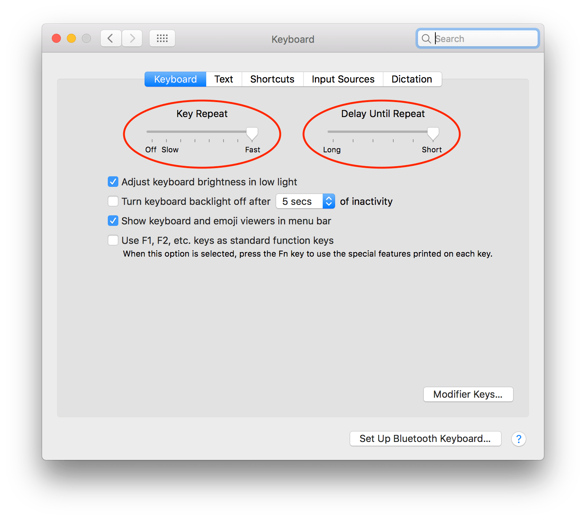
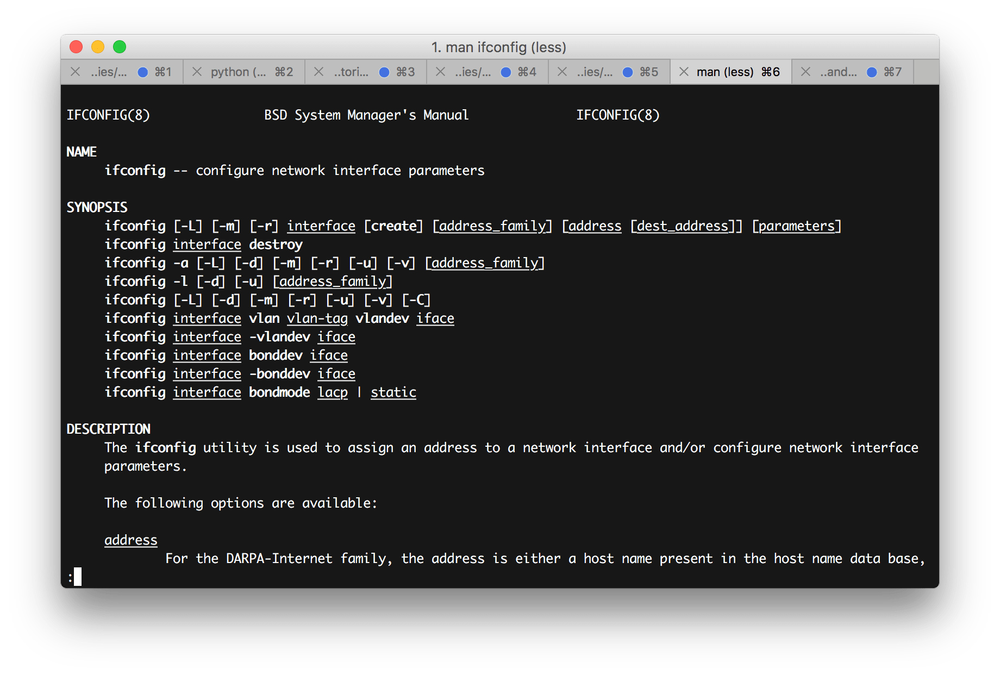
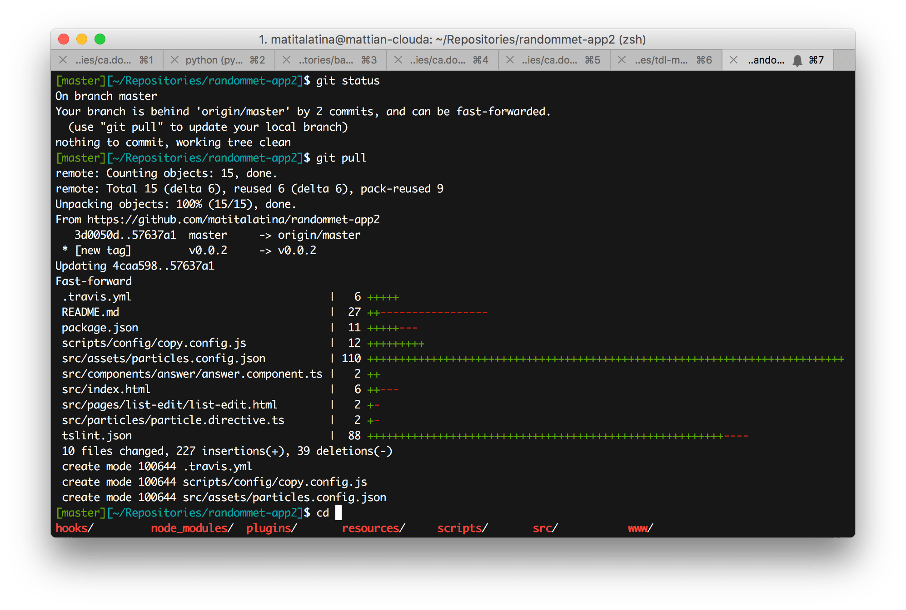
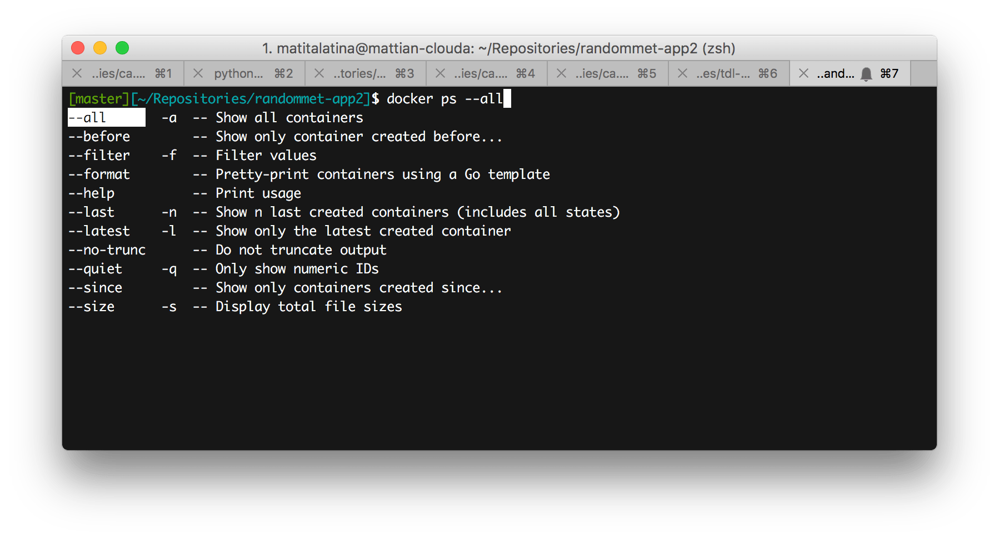
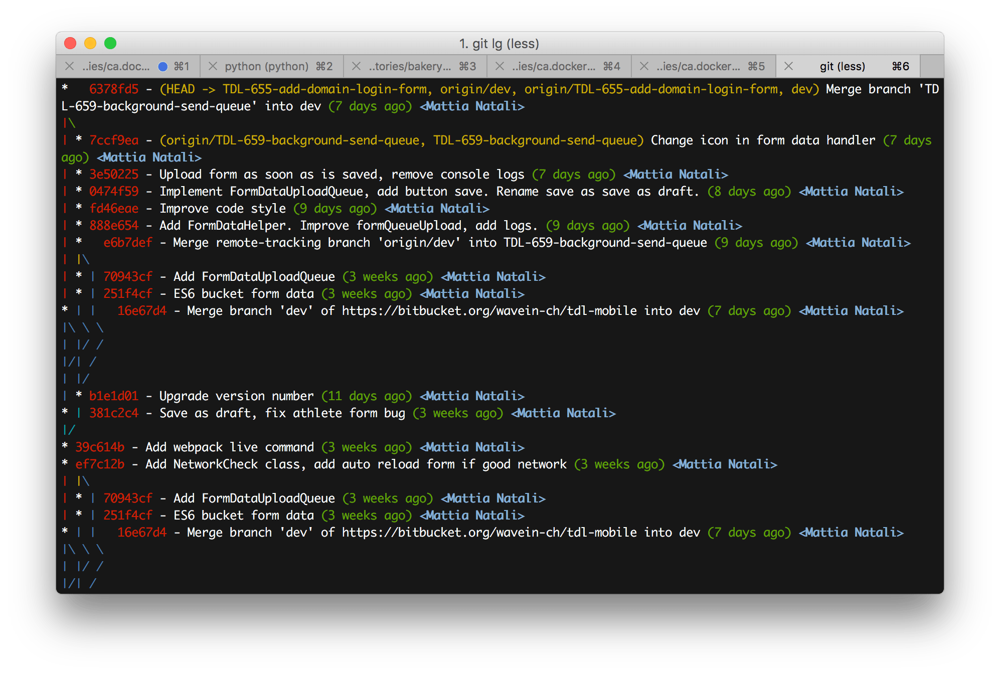
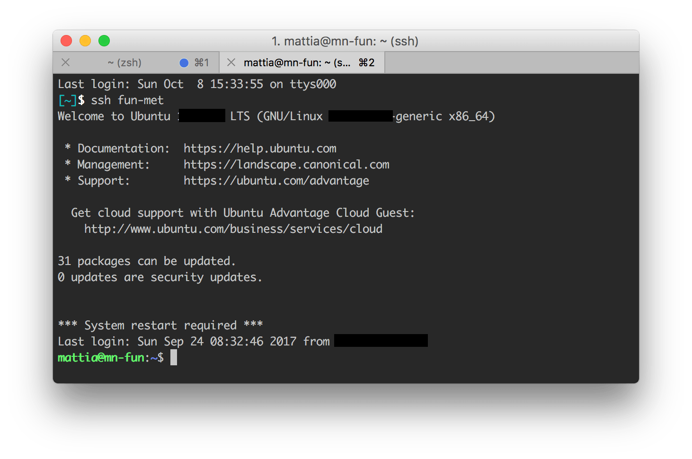

If you're reading this blog post I imagine you're more or less in the same situation as me. You're a developer and you have 8 hours a day to work: in this span of time you have to review other people's code, attend meetings, manage your millions of issues and maybe even other people's, help those who ask you for help, think about how to reach your goals and finally program what you've thought of.

Doing all these things and staying within the set 8 daily hours is hard without disappointing anyone's expectations. So, as good engineers/developers, you're trying to optimize everything.

In this blog post I'll explain how I tried to optimize my time spent in front of the terminal. I'll focus especially on the Mac operating system, which is the one I currently work on.

In this guide I don't want to explain how to use the terminal. That's a prerequisite for me. My goal is to share with you many little tricks that will save you time in your working daily life so that you can focus more on the activity that actually brings value: programming.

# The basics

## Let's speed up the cursor

Let's start with a small optimization that's as simple as it is effective, even before opening the terminal. Many times in the terminal or in your IDE you need to move the cursor. By holding down the arrow keys the cursor moves until you release the key. Well, nothing new so far. The exasperating thing is how slowly this cursor moves! Many people I see, to go fast, start pressing the arrows compulsively or simply wait precious seconds until the cursor moves to the desired position.

A simple optimization everyone should do is to **decrease the time before key repetition starts and the interval between one repetition and the next**.

To do it it's very simple. On Mac go to Settings -> Keyboard -> Keyboard tab. Set *Key Repeat* to *Fast* and *Delay Until Repeat* to *Short*. Now try it and the difference will be huge. I know at first the cursor seems too fast, but then you get used to it and never go back!




## Shortcuts

This advice applies in general to every program. **If you often use the same function, try to learn its keyboard shortcut**. It's definitely faster not to lift your fingers from the keyboard. It happens that the shortcut can't exist for your function; fortunately most of the time you can create it in the settings. I recommend spending some of your time creating these shortcuts: you'll save precious time in the long run.

## iTerm

The Mac terminal is good, but if you want even more you can use [iTerm](https://www.iterm2.com). Basically it's like the native terminal but it has the following additional features that will increase your productivity:

* **Improved search**: press `cmd + F` and open search mode. Type the keyword to search and it will immediately highlight your word in the terminal. Using `cmd + G` and `cmd + shift + G` you can search for the next or previous word.

* **Split panels**: you can split the view both vertically (`cmd + D`) and horizontally (`cmd + shift + D`) so you can have more terminals on a single page. Very useful if you have multiple programs running and need to monitor them at the same time.

* **Customizable profiles**: with a profile you can completely customize the terminal such as colors, shortcuts. If you spend a lot of time connected to remote machines it's easy to get confused between the various open tabs. A great way to avoid making a mess is to use different profiles for machines with different purposes. Our good DevOp uses this technique daily: for the production machine he has a beautiful bright red background, so he clearly understands to be careful and not stay there too long. For the stage environment it's blue, the rest black background.

* If you're curious about iTerm I recommend reading the [other noteworthy features](https://www.iterm2.com/features.html), but above all trying it!


## Everyday business

Here's a list of tricks I use daily in the terminal. I wrote all the ones that come to mind; some will be obvious to those who live all day in front of the terminal, others I hope not ?.

* `tab`: Just a few letters of what you want to type are enough, then press `tab` for autocompletion. This is very useful for example when navigating between tabs.
* `sudo !!`: how many times have you typed `apt-get install` without giving root permissions? Many, after reading the error message, press `up arrow` and then move the cursor to the beginning of the command and finally insert the word `sudo` to become root... What a waste of time! Just type `sudo !!` and boom! Done. Basically `!!` is replaced with the previous command and that's exactly what we wanted.
* `cd`: returns to your home. Why type `cd ~` or worse `cd ../../../../../` to go back home if `cd` is enough?
* `cd -`: returns to the previous directory. Very similar is the `git checkout -` command: it checks out the branch we were working on previously.
* `lsof -i :<PORT>`: Mac only. This command is used to identify the program that's using port `<PORT>`. Very useful when a program gets stuck in the background and you desperately need the port free. Once you've run the program just take note of the program's PID and then `kill <PID>`. Now the port is free!
* Concatenating commands: why stare at a command until it finishes and then run the next one? Using `&&` and `;` you can concatenate multiple commands. `&&` runs the second command only if the first finished successfully, while `;` runs it regardless.
* `ctrl + c`: used to close applications but also to quickly delete what we're typing.
* `ctrl + a` and `ctrl + e`: move the cursor to the beginning and end of the command we're typing respectively.
* `ctrl+l`: clears the terminal, much faster than typing `clear`!
* `!$`: takes the last argument of the previous command. Very useful in cases like these
    `mkdir -p i/am/creating/a/new/folder/ && cd !$`
    As you may have guessed I'm creating a folder, and once created I enter it without having to type the whole path again.
* `man <APPLICATION>`: how many times has it happened that you didn't remember the options of a command and went online to look for the documentation? No need to go online! Just type `man` followed by the application and you'll have all the documentation at hand without googling.


* `cmd + t` and `cmd + w`: open and close a new terminal tab respectively. If you notice these commands are "universal", that is, they also work with browser tabs, finder tabs, your favorite text editor, etc.
* `open .`: opens the folder we're in in Finder.

### Navigating commands and auditing

* `last`: shows who is connected to the machine with the terminal or who connected previously.
* `w`: very similar to `last`. Shows the people currently connected to the machine.
* `up arrow`: inserts the previously executed command. Very useful to review the command or modify it in case of a typo. If you keep pressing `up arrow` you go back in the history.
* `history`: shows all executed commands. Together with the `grep` command it's very easy to search for a command. For example, had you started an app using `runserver` but don't remember all the options by heart? Just type a piece of the command, in our case we type `history | grep runserver`.
* `ctrl + r <TEXT_SEARCH>`: it's called *reverse-i-search* and it means "search the past for a command similar to this". In short it's like the previous command only even faster. For example we can press `ctrl + r` and then type `runserver` to have the command we were looking for in the terminal. If the command you were looking for isn't the last one but a previous one, keep pressing `ctrl + r` until you find the desired command again!

## Let's go further!

### Fuck!

Everyone happens to mistype some command: when we make a typo and see the terminal answer us with a no, the first thing we think is "fuck". With [thefuck](https://github.com/nvbn/thefuck) we can vent our anger productively!
This app is as simple as it is brilliant. If we mistype a command, we just type `fuck` in the terminal; this way this app proposes the previous command written correctly. See it as an **automatic corrector for the terminal**.


Installation is very simple: having installed [Homebrew](https://brew.sh/) we just type

```
brew install thefuck
eval $(thefuck --alias)
```

Good! Now if you mistype some command get angry and type `fuck` and you'll be more productive!


### Zsh

We often find bash as the default installed shell. If you want that extra gear I recommend using Zsh together with the Oh My Zsh! plugin. This combo will allow you to be more productive for the following reasons:

* **Improved folder autocompletion**: better navigation between the proposed choices.
* **Autocompletion for the most used programs**: Git, Docker, npm, Django are the Oh My Zsh plugins I use, but [there are many others](https://github.com/robbyrussell/oh-my-zsh/tree/master/plugins)!
* **[Fully customizable themes](https://github.com/robbyrussell/oh-my-zsh/wiki/themes)**: there are many ready-to-use themes, you'll surely find one that satisfies your personal taste. My favorite is `eastwood`.
* **Greater Git integration**: as soon as we enter a folder containing a project versioned with Git, we can notice that the branch we're on is shown and also a small alert when we haven't committed and pushed all our code. Thanks to these little aids we'll save many `git status`.
* **Improved search of previous commands**: type only the beginning of a command, then pressing `up arrow` shows you the previously used command that starts exactly the same way.


#### Installation

If you want to install Zsh with Oh My Zsh! these are the steps to follow:

```
brew install zsh zsh-completions
sh -c "$(curl -fsSL https://raw.github.com/robbyrussell/oh-my-zsh/master/tools/install.sh)"
``` 

Now restart the shell; to use Zsh just type `zsh`.

If you want Zsh to become your default shell then type

```
chsh -s $(which zsh)
```

#### Changing the theme

Zsh configuration files are in the `~/.zshrc` file. With your favorite editor modify the `ZSH_THEME` variable. If you don't know which theme to choose, you can use `random` mode: this way every time you open a shell you'll have a different theme. When you find one you like, take the name of the theme that appears at startup and write it in the aforementioned variable.

As I said before, I'm using `eastwood`. It has very relaxing colors and doesn't distract too much compared to other themes.





#### Changing the plugins

Also in the `~/.zshrc` file we can find the `plugins` variable. You can see plugins as improvements in autocompletion for applications you often use in the terminal.

I currently use this configuration.

```
plugins=(django npm docker)
```

I remind you to separate the plugins with a space and not with a comma. Of course [Zsh offers many other plugins](https://github.com/robbyrussell/oh-my-zsh/tree/master/plugins), choose the bare minimum because they could slow down the terminal startup.





### Aliases, aliases everywhere!

In the terminal you can add aliases to speed up the execution of one or more commands. If you notice that you **always type the same command** (or even a series of commands) then it means it's time to **add an alias**.

Adding an alias is simple: you need to add them in the `~/.bash_profile` file if you use bash or `~/.zshrc` if you use Zsh.
The syntax to add one is the following:

```
alias <ALIAS>="<COMMAND>"
```

Here are some of my aliases as an example:

* `alias gbd="git branch | grep -v '*' | xargs git branch -D"`: running `gbd` (Git Branch Delete) will delete all local Git branches of the project contained in the folder. Only run it if you're sure of what you're doing!
* `alias pycc='find . -name "*.pyc" -exec rm -f {} \;'`: running `pycc` (pyc clean) will recursively delete all compiled Python files present in the folder. Very useful when refactoring in Python and we fear that the compiled files no longer match the source code.
* `alias yda='youtube-dl -x --audio-format m4a --audio-quality 160k'`: running `yda <YOUTUBE_URL>` (YouTube Download Audio) will download the audio file of a YouTube video. This command only works if you followed my guide on [how to download a video from YouTube](/en/how-to-download-youtube-videos-with-the-terminal/).
* `alias ddev='docker-compose -f <ABSOLUTE_PATH_DOCKER_YAML_FILE>'`: running `ddev <DOCKER_COMPOSE_COMMAND>` (Docker dev) you can give any command to your Docker Compose without worrying about the folder you're in. Without this command I was always forced to go to my Docker Compose project folder `cd <PATH_TO_DOCKER_COMPOSE_PROJECT>` and then type `docker-compose -f <DOCKER_YAML_FILE> <DOCKER_COMPOSE_COMMAND>`... All wasted time!
* `alias c<PROJECT_NAME>='cd <PROJECT_NAME_ABSOLUTE_PATH>'`: if you have a project you work on daily I recommend creating an alias to reach it quickly. As a convention I use the initial letter `c` which recalls the `cd` command and then the project name.


#### Git

**Git also supports its own internal alias mechanism**. Open or create the `~/.gitconfig` file. Inside it let's add

```
[alias]
    st = status -sbu
    lg = log --color --graph --pretty=format:'%Cred%h%Creset -%C(yellow)%d%Creset %s %Cgreen(%cr) %C(bold blue)<%an>%Creset' --abbrev-commit
```

As you can guess we added the alias section and added two new git aliases.
Once we've restarted the terminal we can use:

* `git st`: a modified version of `git status`.
* `git lg`: shows the commit tree.

Of course these are two of my commands but nobody forbids you from creating your own!




#### SSH

Access to a remote machine can also be sped up. I imagine the machines you connect to remotely are always the same, and typing `ssh <USERNAME>@<REMOTE_ADDRESS> -i <PRIVATE_KEY_PATH>` in the terminal every time is long, tedious and hard to remember. It's a whole other story if we could connect simply by typing `ssh <ALIAS>` where `<ALIAS>` is the name we gave to the remote machine. All this is possible thanks to the `~/.ssh/config` configuration file. If the file isn't present, you can create it by typing `touch ~/.ssh/config`. Through this file **we can save remote connections and recall them via an alias**, without necessarily rewriting all the parameters every time.

The `~/.ssh/config` file has the following syntax:

```
Host <ALIAS>
    HostName <REMOTE_ADDRESS>
    Port <PORT>
    User <USERNAME>
    IdentityFile <PRIVATE_KEY_FILE>
```

Replace the variables written between angle brackets with your parameters: this way instead of typing

```
ssh <USERNAME>@<REMOTE_ADDRESS>:<PORT> -i <PRIVATE_KEY_FILE>
```

now you just type

```
ssh <ALIAS>
```

much, much faster and more immediate.
In the configuration file the `HostName` and `User` fields are mandatory, the rest are optional. You can add more Hosts if you have different machines you access remotely.

The available SSH parameters aren't only these; if you need advanced features like tunneling I recommend reading the [official SSH Config File guide](https://www.ssh.com/ssh/config/).



### Curiosities

These commands aren't related to productivity, but they're still noteworthy.

* `say '<TEXT>'`: did you know the Mac can talk and you can make it talk through the terminal? By combining this command with `ssh` we can make a Mac talk even remotely. So nobody forbids us from sending a love message to our girlfriend through the command `ssh girlfriend@<IP_ADDRESS> say 'I love you!'`, try it and observe her reaction! (Spoiler: she won't appreciate it, I can assure you ?).
* `yes`: if you have a temporary chilblain and need a heat source, then I recommend starting `yes` from the terminal. This command does nothing but send the CPU to 100%!

# Conclusions

I hope all these tricks of mine help you in your daily life to reach your work goals in the shortest time possible. There will surely be millions of other tips and tricks I'm not aware of: if I learn others I'll try to add them here so I can share them with you.

See you soon, good work and see you next time!
