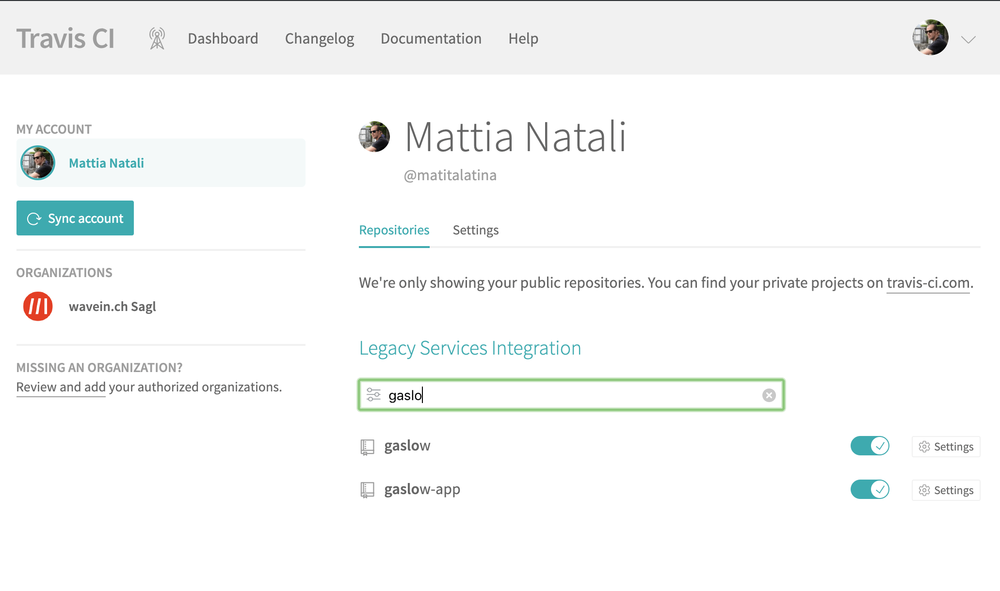
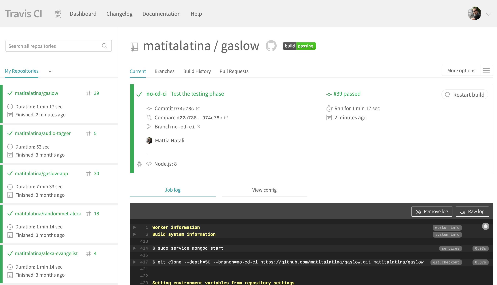
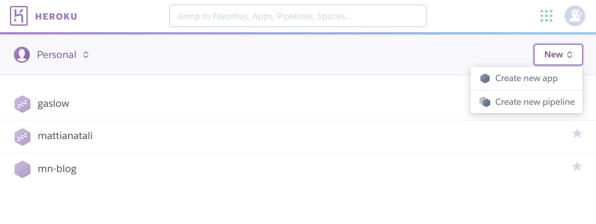
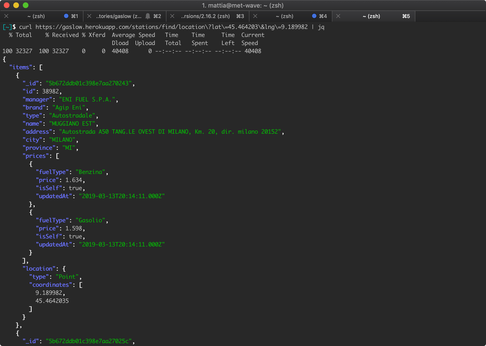

# Introduction

One thing I learned at Pirelli is the implementation of pipelines to get Continuous Integration (CI) and Continuous Deployment (CD), from now on I'll simply call it [CI/CD](https://en.wikipedia.org/wiki/CI/CD). Many projects with a microservices architecture are always being born: time at work is always short and repetitive work bores me easily... What's more repetitive than putting all these microservices into production? These automatic pipelines therefore become essential so as not to spend the day doing only this boring job.

I don't want to bore you too much talking about the various advantages that CI/CD brings; if you've come to this post it means you already know, so I'll start right away with a practical example.

## Creating the pipeline for GasLow Backend

As an example I'll use the backend of a project I created in my free time: [GasLow](https://github.com/matitalatina/gaslow). Basically it's a backend that's able to retrieve open data about fuel prices in Italy and provide this information based on your location. The Android app, based on [Flutter](https://flutter.dev/), that uses this backend is [available for free on the Play Store](https://play.google.com/store/apps/details?id=it.mattianatali.gaslowapp&hl=en).

The important things for us are these:

- The backend is written in Node.js + TypeScript, the database is MongoDB.
- The configuration file with the data to connect to the DB is in the `.env` file, in the project root. Of course the file isn't published on Git to avoid the whole world knowing the DB credentials. You can see an example of the data contained in this file by reading `.env.example`.
- The "production" server is on [Heroku](https://www.heroku.com/) on a free machine. In this guide we'll be able to automate the deploy to Heroku.
- I'm also implementing the AWS serverless version, where it's deployed using CloudFormation. Unfortunately this part is a bit too much to explain in this introductory guide on CI/CD. Maybe I'll make a dedicated guide on this topic in the future.


# Prerequisites

To fully understand this guide we need these skills:

- At least a basic knowledge of [Git](https://en.wikipedia.org/wiki/Git_(software)).
- How a [Node.js](https://nodejs.org/) project is structured and the basic commands of its package manager [npm](https://en.wikipedia.org/wiki/Npm_(software)). This part actually isn't mandatory to understand the pipeline as a concept, it's only needed to understand the pipeline of this specific example.

# Let's choose the CI/CD service

The first important step to automate everything is choosing the service we want to use. The choice is really wide. The ones I know and have used are these:

- [CircleCI](https://circleci.com/): very powerful and flexible. It's hosted by them and so we don't need our own machine to run it. It offers a free plan of 1000 minutes/month for both your public and private projects; not bad for hobby use. For now it's my first choice for my private projects and it was what I used at Pirelli until a month ago.
- [GitLab](https://about.gitlab.com/): this is also as powerful as CircleCI. You can use the version hosted by them or install it on your machine. It's a bit different from the others because it offers a complete package for your project (it has Git integrated so you can use it as a repository too). For now it's our first choice at Pirelli and in fact we're doing a nice migration from CircleCI.
- [Travis CI](https://travis-ci.org/): maybe it's a tad behind the first two. For example it's not yet possible to do a manual deploy, [unless you come up with hacks like this](https://stackoverflow.com/questions/50831785/travis-manually-confirm-next-stage). By manual I mean having a button that allows us to run a deploy only after a confirmation. This feature is very useful for me to have full control of when we want to deploy to production. Apart from this small flaw it has a huge advantage: it's free for all public projects! Precisely for this reason I use it for my public projects (like GasLow). **Our guide will be based on Travis CI**.
- [Jenkins](https://jenkins.io/): it's a milestone and the oldest of all. I've used it only a few times and honestly it never excited me that much, especially as far as UX is concerned. But this is my personal opinion and therefore quite subjective.

# Goal of the guide

In this guide I'd like to experience with you the **creation of a pipeline with an already started project that's already in production**. Why do it with an already started project? Because it's a typical use case you encounter at work and it's probably your current situation; finally because the web is already full of "hello world" for creating pipelines. But usually they are examples focused on learning the service that offers the pipelines, and not so much on learning the concepts and difficulties encountered in real life.

Let's make clear what we want to achieve: let's imagine we're at work and as the task of the week we've been asked to create the CI/CD pipeline for the GasLow project.
At the end of the guide we'll have a pipeline made up of two phases:

- Running the tests: a fundamental step to get **Continuous Integration (CI)**.
- Deploy to production on the Heroku machine: a step to get **Continuous Deployment (CD)**.

This is the bare minimum to get a complete CI/CD pipeline and to not make the guide too long we'll limit ourselves to these two steps.
Once you've become familiar with the topic you can complicate the pipeline as you like. For example a typical pipeline I use at work is made up of the following steps:

- Build and unit tests of the application.
- Creation of the Docker image through the Dockerfile, push of the image to the AWS ECR repository.
- Database migration and deploy of the Docker image in the DEV environment.
- Integration tests on the DEV environment.
- Database migration and deploy with manual confirmation in the QLT environment used by our QA Team.
- Database migration and deploy with manual confirmation in the Production environment.

# Signing up to Travis CI

This step is very simple; just go to their [home page](https://cdn.travis-ci.org/images/landing-page/laptop-f308ed79defa4f49c5f01af29a60084d.png) and press the "SignUp" button, enter your GitHub credentials, and at this point you've effectively connected Travis CI to your GitHub. Once you've done this you'll enter the Travis CI main page.


on the left your GitHub projects that use Travis CI as a CI/CD service will appear. At the beginning it will obviously be empty. For now we don't need to know anything else.

# Forking the project

If you want to try it out yourself too, you can fork my project and throw away the `.travis.yml` file because we'll recreate it together to form the pipeline we have in mind.
The reference commit has the hash `d09f1068a14ddcdb857f1ced90b532680b050917`, so to be perfectly aligned with this guide we'll need to check out this specific commit; I don't rule out that the project may have deep changes over time.

```bash
git checkout d09f1068a14ddcdb857f1ced90b532680b050917
```

Once forked and the file removed we can go to the Travis CI settings (user menu at the top right -> Settings). On this page all our repos should appear, including this newly forked one. If you don't see anything click on the `Sync Account` button to synchronize Travis CI. Then we can see the gaslow repo as in the figure; let's enable the toggle.
Now we have the forked repo, Travis CI ready and connected to it. Now the fun part begins: let's set up the first step of our pipeline.




# Implementing the Continuous Integration pipeline (testing phase)

## Testing locally

Before going on to create the pipeline let's ask ourselves this question: how do you run the tests locally? **The best way to create an automatic pipeline is to think of all the various steps we have to do locally to achieve the same goal**. Here I take for granted that we have a minimum of experience in Node.js and how the `npm` package manager works.

Someone who breathes Node.js from morning to night has already thought about how to do it: there's the `npm test` command... But are we sure that's enough? In this case we're taking for granted a few things that for Travis CI won't be at all.

To run the tests with `npm test` we're taking for granted the following points:

- Node.js v8 is installed on your machine.
- On your machine we have MongoDB installed and active on the standard port `:27017`.
- We've installed all the dependencies (through the `npm install` command) and therefore we have the `node_modules` folder correctly populated.

So the correct steps to run the tests on a clean machine are the following:

- [Install Node.js v8](https://nodejs.org/en/download/).
- [Install MongoDB](https://docs.mongodb.com/manual/installation/) and activate it on the default port `:27017`.
- `npm install` to install the dependencies present in the `package.json` file and therefore populate the `node_modules` folder.
- `npm test` to run the tests.

## Testing using Travis CI

Now that we've understood the local steps, let's try to translate them into steps that can be digested by Travis CI.

To make Travis CI run the tests automatically we need a means of communicating. **The way to communicate with this service is the `.travis.yml` file**, precisely the file I had you delete during the project fork. You may be unfamiliar with the file extension. `yml` is used for the *YAML* format which stands for (*YAML Ain't Markup Language*). It has become the de-facto standard in the DevOps world because on one hand it's "expressively" very powerful, on the other it's very simple for a human to read.
This format, however simple it may be to read, has many rules that take some time to master and know all of them. Anyway we don't have to worry too much: we'll only use the bare minimum and very basic concepts. I usually use [Learn yaml in Y minutes](https://learnxinyminutes.com/docs/yaml/) as a cheatsheet for yaml: this site is very concise and at the same time rich in information; give it a look for other languages too, you won't regret it.

Let's start by creating the `.travis.yml` file in the project root. Inside it let's insert this content:

```yaml
language: node_js

node_js: '8'

services:
  - mongodb

install: npm install
script: npm test
```

This way, Travis CI is able to run our tests. Let's try committing the file; indeed we see that Travis CI has started working and has run the tests.

Now let's try to see the similarities with the steps we needed locally:

- Did we tell Travis CI to install Node.js v8? Yes, through the directive
  
  ```yaml
  language: node_js

  node_js: '8'
  ```
  
- Did we tell Travis CI to install MongoDB and open Mongo's standard port? Yes, through the directive
  
  ```yaml 
  services:
    - mongodb
  ```

- Did we install the project dependencies before running the tests? Yes, through running the `npm install` script during the installation phase of our job, through the directive
  ```yaml
  install: npm install
  ```
- Did we run the tests? Yes, through running the `npm test` script during the main phase of the job, through the directive
  ```yaml
  script: npm test
  ```

So we can say we've executed the same steps we did locally using a language that Travis CI understands. I don't want to dwell too much on the language Travis CI uses because it's very specific to the service we're using: CircleCI, GitLab would have used a slightly different language. What must come across here is this: **Travis CI is like a blank sheet of paper**; it's up to us to instruct it how to run our tests. The best way to instruct it is to **first think about the steps we do locally, then redo them in the language of the platform we use**.

For those who want to know more about the specific Travis CI language, I'll leave some links here that go deeper into the topics just covered:

- [To learn about the supported languages](https://docs.travis-ci.com/user/languages/), specifically [JavaScript](https://docs.travis-ci.com/user/languages/javascript-with-nodejs/).
- [To learn how to add new services](https://docs.travis-ci.com/user/database-setup/) like MongoDB.
- [To learn about the various phases of a job](https://docs.travis-ci.com/user/job-lifecycle/).



## Deployment using Travis CI

Now that we've run the tests we want to deploy our code to Heroku. [Heroku](https://www.heroku.com/), for those who don't know it, allows you to deploy your code on their [PaaS](https://en.wikipedia.org/wiki/Platform_as_a_service) platform.

**Before creating the pipeline, we need to create an application on Heroku,** fortunately they give you the possibility to host our project for free.

Let's sign up and create a new app.



Now let's go back to the `.travis.yml` file and add at the end:

```yaml
before_deploy:
  - <MYSTERIOUS_STEP>
  - npm run build
deploy:
  provider: heroku
  api_key:
    secure: '<API_KEY>'
  app: <HEROKU_APP>
  on:
    branch: master
  env:
    - NODE_ENV=production
  skip_cleanup: true
```

A little explanation of what we've added:

- `before_deploy` is the keyword to define what to do right before the *deploy* phase. The deploy phase is the step within a job that's dedicated to deploying our code to Heroku. The *job*, for Travis CI, essentially consists of three phases: *install*, *script* and *deploy*. If you want to go deeper, you can read the [various phases that make up a job directly from the Travis CI documentation](https://docs.travis-ci.com/user/job-lifecycle/).
- `<MYSTERIOUS_STEP>` is an essential step for the deploy that I haven't told you yet; I'll talk about it later.
- `npm run build` is the script we need to run before the deploy. This script is strictly tied to our project. If you're curious you can go to the `package.json` file and see that the build script runs the command `parcel build src/server.ts --target node`. It does nothing but call [Parcel.js](https://parceljs.org/) to [transpile](https://en.wikipedia.org/wiki/Source-to-source_compiler) the TypeScript code into JavaScript, bundle it, minify it and put it in the `/dist` folder. At the end of this project we therefore have the `/dist/server.js` file ready to be run in production.
- `deploy` is the keyword to define what to do during the deploy phase.
- With `provider` we define that we're using Heroku as the platform.
- `api_key` is used to define the credentials to actually deploy with Heroku. The next step will be to replace `'<API_KEY>'` with the real (encrypted) keys.
- `app: <HEROKU_APP>` tells Travis CI which Heroku app we want to deploy to. We need to replace `<HEROKU_APP>` with the name of the Heroku application we created in the previous step.
- With `on: branch: master` we can deploy only when we push to the `master` branch. Without this directive every single push to any git branch would trigger the automatic deploy.
- With `env:` we can define the environment variables that our project will have available on Heroku. In our case we added the `NODE_ENV=production` variable which is a standard in the Node.js world to define that we're in a production environment.
- `skip_cleanup: true` allows us to avoid deleting the files generated in the previous step. During the test phase we ran the `npm install` command which populates the `node_modules` folder that's essential for the correct functioning of the system. This way we can avoid redoing it and therefore save time in the deploy phase. We must imagine that the *deploy* phase is separate from the *script* phase, so we'd only have the source code without this directive.

If we want to know all the various parameters we can use to deploy to Heroku [we can read the official documentation](https://docs.travis-ci.com/user/deployment/heroku/).

To recap there are still two things to do:

1. Understand what we need to do in the `MYSTERIOUS_STEP`: it has to do with the configuration of our project in production. Here's a hint: go read the [src/util/secrets.ts](https://github.com/matitalatina/gaslow/blob/master/src/util/secrets.ts) file. 
2. Retrieve the encrypted Heroku `API_KEY` so that Travis CI can authenticate and run the deploy.

### Understanding the mysterious step

There's a part I've kept hidden from the start and now it's time to talk about it. We said the project is based on MongoDB, but where does it get the credentials to connect? We ran tests earlier, yet it seems it connected without problems. Even Travis CI, during the tests, connected.
We can read the retrieval of the connection information in the [src/util/secrets.ts](https://github.com/matitalatina/gaslow/blob/master/src/util/secrets.ts) file which I'll quote here for simplicity:

```typescript
import logger from "./logger";
import dotenv from "dotenv";
import fs from "fs";

if (fs.existsSync(".env")) {
    logger.debug("Using .env file to supply config environment variables");
    dotenv.config({ path: ".env" });
} else {
    logger.debug("Using .env.example file to supply config environment variables");
    dotenv.config({ path: ".env.example" });  // you can delete this after you create your own .env file!
}
export const ENVIRONMENT = process.env.NODE_ENV;
const prod = ENVIRONMENT === "production"; // Anything else is treated as 'dev'

export const SESSION_SECRET = process.env["SESSION_SECRET"];
export const MONGODB_URI = prod ? process.env["MONGODB_URI"] : process.env["MONGODB_URI_LOCAL"];

if (!SESSION_SECRET) {
    logger.error("No client secret. Set SESSION_SECRET environment variable.");
    process.exit(1);
}

if (!MONGODB_URI) {
    logger.error("No mongo connection string. Set MONGODB_URI environment variable.");
    process.exit(1);
}
```

In practice the code behaves like this:

- It retrieves the `.env` file; if it's not there it falls back to the `.env.example` file.
- It retrieves the `SESSION_SECRET` value from this file.
- It retrieves the `MONGODB_URI` value if you're in production, otherwise `MONGODB_URI_LOCAL`.

Finally we can understand how the tests managed to connect to MongoDB without us doing anything: in practice it fell back to the `.env.example` file which is versioned on Git, read the value `MONGODB_URI_LOCAL=mongodb://localhost:27017` and therefore connected to our local MongoDB, while Travis CI connected to the MongoDB service we instantiated in the pipeline.

Our task is to **find a way to load the `.env` file in production** securely, versioned, but at the same time without having all the credentials to access our MongoDB written in clear text.

### Loading the .env file securely

A solution to the previous problem is given to us [directly by Travis CI](https://docs.travis-ci.com/user/encrypting-files/). For this step we need the [Travis CI Command Line Client](https://github.com/travis-ci/travis.rb#readme) which on Mac we can install like this:

```bash
sudo gem install travis
travis login
```

Thanks to it we can encrypt files securely and save the encrypted file in the repo without fear that someone can steal our credentials.

The first step is to create the `.env` configuration file ready for production; **we must be careful not to upload it to Git for any reason**, it's not encrypted and if we version it anyone is able to access our DB! If you're working on my project I've already taken care of it. In fact if we go to the [.gitignore](https://github.com/matitalatina/gaslow/blob/master/.gitignore) file we notice that the .env file is in the blacklist of files not to consider with Git.

So let's create the `.env` file with the same data you find in the `.env.example` file

```
# Get this from https://mlab.com/home after you've logged in and created a database
MONGODB_URI=mongodb://<mlab_user>:<mlab_password>@<mlab_connection_url>

# This is standard running mongodb locally
MONGODB_URI_LOCAL=mongodb://localhost:27017

SESSION_SECRET=<session_secret>
```

We need to modify two parts:

- In `MONGODB_URI`, replace `<mlab_user>`, `<mlab_password>`, `<mlab_connection_url>` with our DB credentials we want to use in production. I use the [mLab](https://mlab.com/) service.
- Replace `<session_secret>` with a random alphanumeric string.

Now let's delete the `.env.enc` file, where my encrypted keys are, because now we'll create our own encrypted file. With the values we just entered in the `.env` file. For this step we use the Travis CI command line.

```bash
travis encrypt-file .env
```

The terminal will tell you to insert a string like this in the `.travis.yml` file

```bash
openssl aes-256-cbc -K $encrypted_0a6446eb3ae3_key -iv $encrypted_0a6446eb3ae3_iv -in .env.enc -out .env -d
```

this is exactly what we need to write in the mysterious step!
So let's update the `.travis.yml` file; the `before_deploy` phase will be like this

```yaml
before_deploy:
  - openssl aes-256-cbc -K $encrypted_0a6446eb3ae3_key -iv $encrypted_0a6446eb3ae3_iv -in .env.enc -out .env -d
  - npm run build
```

The command we just added does nothing but decode the encrypted file before deploying.

### Getting the encrypted Heroku API key

We're almost at the end; now we just need to **insert the encrypted API key into our pipeline to allow Travis CI to deploy through Heroku**.

For this step we need [Heroku CLI](https://devcenter.heroku.com/articles/heroku-cli) installed on our PC. If you have a Mac just type in the terminal (if you installed [brew](https://brew.sh/))

```bash
brew tap heroku/brew && brew install heroku
```

We authenticate with Heroku using the command

```bash
heroku login
```

and finally we type this command to get the API Key

```bash
travis encrypt $(heroku auth:token)
```

The command will return the API Key; we need to insert it in place of `'<API_KEY>'` in the `.travis.yml` file.
Once this is done we'll have finished the work and can enjoy our Continuous Integration and Continuous Deployment pipeline!



# Tips for creating pipelines

Now that we've seen a real use case I want to share some advice with you. I hope they'll help you avoid a few headaches that I got instead:

## The sooner we create it, the simpler it is

**The earlier you create the CI/CD implementation, the more time you save, but above all the simpler it is!** Ideally it's better to do it during project creation. There are many reasons:

- **During project creation we're already working on the project's configuration and dependencies**. So everything we're doing locally to set up our local environment, we just need to do the equivalent in the pipeline. Moreover if we know we're implementing a pipeline from the start, **we avoid creating tests or configurations that are too tied to our local machine**, we avoid writing strange configurations that complicate the pipeline precisely because it's hard for us to replicate them in Travis CI (such as retrieving files that are in folders outside our Git project).
- **We don't have to do Reverse Engineering on the project to understand how to configure it**: nobody will warn us to find "the mysterious step" in real life and nobody will tell us to look at the [src/util/secrets.ts](https://github.com/matitalatina/gaslow/blob/master/src/util/secrets.ts) file to get a hint. In this guide I did it to avoid wasting too much time. Without this help we would have had to bang our heads several times and do a minimum of Reverse Engineering of the project to actually understand how the credential retrieval worked. All this could have been avoided if whoever designed this credential retrieval had kept the pipeline up to date. And whoever is new to the project just needs to look at the `.travis.yml` file to understand exactly the procedure to get a working local version.
- **Human error in deploys is avoided**: having automated it is an advantage because there are no gross errors in the deploy. Imagine you have to run numerous deploys a day... After a while you'll lower your guard and concentration, the error from carelessness is around the corner and making mistakes in deploys can cost a lot!
- **You save time**: banally, the sooner we create a pipeline the more man-hours we save. Nobody in the company is responsible for the deploy, anyone can do it. I've been in companies where the deploy was manual, and I saw a person who was fully occupied just with deploys during the most hectic moments. In my opinion that's unacceptable. The tools to automate exist and are within everyone's reach. Let's use them!

## Let's think about setting up the pipeline locally

Trying directly on Travis CI can take a lot of time. For example if we have problems in the deploy, we have to push the new changes, wait for all the previous steps and then maybe find a nice error after 15 minutes. In this case we try to fix the problem by uploading the new changes and the cycle starts again... All this takes hours.
**The best way to avoid all this is to try the steps locally**. A bit like we did in this guide during the creation of the Continuous Integration pipeline.
To achieve this goal we need to create steps that are agnostic with respect to the CI/CD service we use. Usually I create a folder with all the scripts useful for the deploy. This way I can invoke these scripts locally too and test the correct execution faster.
Moreover if we keep this point in mind it will also be easier to achieve the next one.

## Let's not focus too much on the single CI/CD service

In this guide we used Travis CI, in my previous job we used Jenkins. In my current job we used CircleCI, now instead we use GitLab CI. In short you'll end up using all sorts of things, but they all solve the same problem: automating integration and deploy.
**So let's try to focus on the basic concepts and not so much on how to do it on a specific service**. This last part is simple if we're clear about what we need to achieve: just read the guide of the specific service. This way of working gives us a lot of flexibility both at work and in our hobby projects.
Finally **this flexibility makes us free to use a service based on the advantages it brings**: in this guide we used Travis CI precisely because it's free for open source projects, but it's certainly not the best on the market. This wouldn't be possible if we used one and only one service.

## Let's read pipelines that are already made

We must remember that we're not the only ones on the face of the earth thinking about creating a pipeline. **So let's not underestimate the possibility of looking at open source project pipelines!** There are numerous projects on GitHub that show practical examples of pipelines that very likely solve all or part of our problems. This way we can also see different ways of reasoning which is always useful for improving our cultural baggage. Finally I remind you that Travis CI is free for open source projects, which is the main reason I decided to write this guide. So GitHub is full of pipelines made with Travis CI!

## Let's not look for perfection

Let's remember that our job isn't to spend days making pipelines. **It's always possible to optimize it to speed it up, but like all optimizations they take time**. My advice is to reach the bare minimum to achieve the goal, even if maybe it's not the most elegant solution possible. Then let's remember that over time we learn new concepts, such as caching and the possibility of running multiple jobs in parallel, we know the system better and so it will be simpler for us to optimize it taking less time. So let's always keep in mind that the pipeline is a tool that speeds up and automates our work... But whether it takes 5 minutes or 10 minutes doesn't really change much on our side, so let's not spend hours or days on these optimizations, especially in the early stages where the challenges are already many.

# Conclusions

I hope that with this guide you've experienced first-hand what it means to implement a Continuous Integration and Continuous Delivery pipeline on an already existing project. The difficulties, as we've seen, are greater if the project is already started. So, the next time you start building an idea of yours, remember to think about the CI/CD pipeline right away; you won't regret it. This way you can delegate these tasks to a machine and you can focus exclusively on what really brings value to your project: code development.

See you next time!
