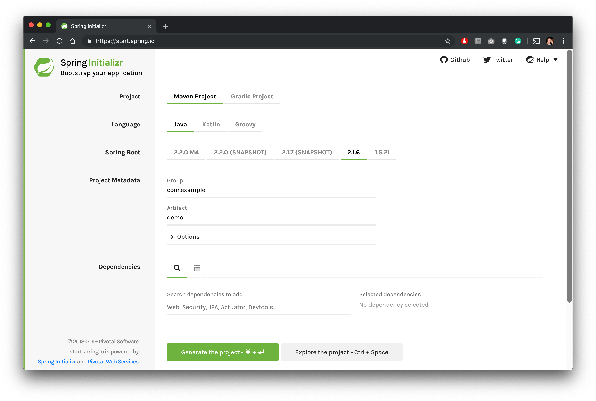
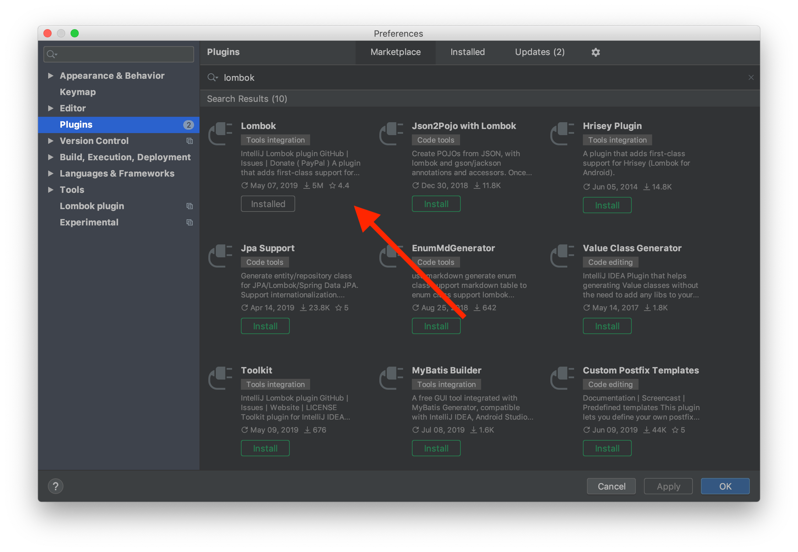
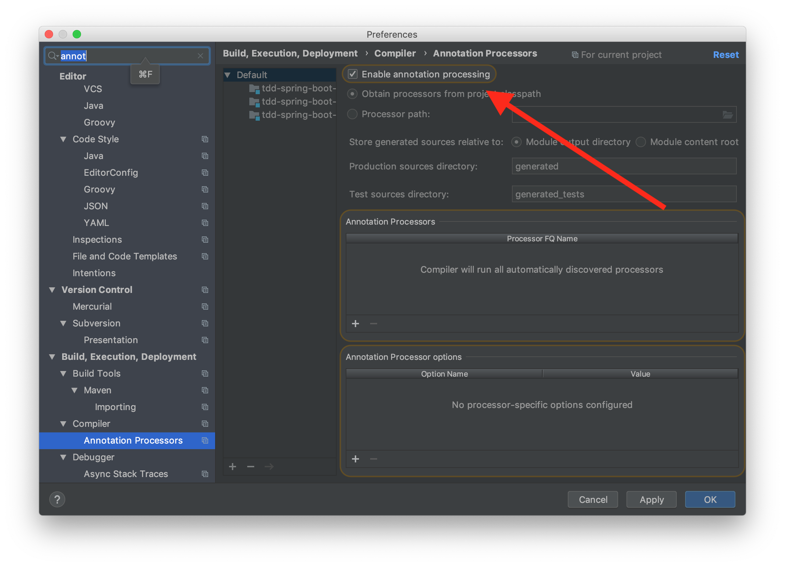
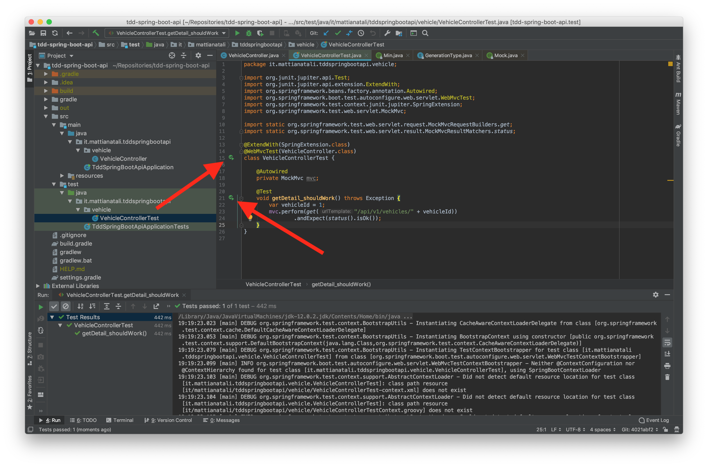

[In this article](/en/how-to-develop-in-test-driven-development-tdd-from-scratch) we saw what it means to develop in Test Driven Development (TDD) and the benefits that come from it. The example used might seem like a pointless little game, but my focus there was to explain TDD to those who had never heard of it at all.

In this guide instead let's look together at a use case that will be much more familiar to us: the development of RESTful APIs. To do this I decided to use the Spring Boot framework; the chosen language is Java.
Spring Boot is widely used in the enterprise world to create a microservices architecture. [Netflix uses it too](https://hub.packtpub.com/netflix-adopts-spring-boot-as-its-core-java-framework/). Moreover Java is a programming language known to everyone by now, so I think it's a good choice to see a practical example together.

As always we start completely from scratch, to leave nothing to chance. In addition to TDD, we'll also see together how to structure the project correctly and other very handy libraries that I use every day to increase our productivity, such as the [Lombok](https://projectlombok.org/) library.

## Requirements

The reader I'm imagining is a **developer who has already heard of Spring Boot, isn't scared if we talk about RESTful APIs, wants to use TDD as the main development driver but can't apply it effectively**.

This article **is a continuation of my [first episode on TDD](/en/how-to-develop-in-test-driven-development-tdd-from-scratch)**, so I strongly recommend reading ["How to develop in TDD starting from scratch"](/en/how-to-develop-in-test-driven-development-tdd-from-scratch) first. This way you'll have an initial grounding in TDD and we'll be aligned on some concepts that I'll take for granted here.

My guide is based on a UNIX-like operating system (Mac OS X), but it can easily be followed by Windows users too.

On our PC, [Java Development Kit 12](https://www.oracle.com/technetwork/java/javase/downloads/jdk12-downloads-5295953.html) must be installed.

## Goal

Let's imagine we need to create two endpoints:

- `GET - /api/v1/vehicles/{id}`: to retrieve a vehicle by id.
- `POST - /api/v1/vehicles`: to add a vehicle.

The vehicle is made up of these properties

```json
{
  "id": 1,
  "brand": "Ferrari",
  "model": "488 GTB",
  "year": 2019
}
```

`brand`, `model` and `year` are mandatory; the vehicle's year of production can't be earlier than `1950` for business reasons.

For now we're not interested in other endpoints.

[You can find the implementation of this small project in this public repository of mine](https://github.com/matitalatina/tdd-spring-boot-api); this way, if you get lost, you can pick up the thread of the discussion by reading the code directly.

## Let's create the project

Now that we have a clear idea of what we need to do, **let's generate the project**.
The best way to do this is to go to the [Spring Initializr](https://start.spring.io/) website. From here we can decide which libraries to integrate, the Java version, etc.



The configuration I chose is the following:

- *Project*: Gradle Project. You've probably already heard of Maven as a dependency manager and build tool for Java. If instead you develop on Android, with Gradle you'll feel at home, since it's the one used by default.
- *Language*: Java.
- *Spring Boot*: 2.1.6.
- *Project Metadata*:
  - *Group*: it.mattianatali.
  - *Artifact*: tdd-spring-boot-api.
  - *Name*: tdd-spring-boot-api.
  - *Description*: Sample project to explain how to develop APIs in TDD with Spring Boot.
  - *Package Name*: it.mattianatali.tdd-spring-boot-api.
  - *Packaging*: Jar.
  - *Java*: 12.
- *Dependencies*:
  - *Spring Web Starter*: provides the various annotations to create RESTful APIs simply and quickly.
  - *Lombok*: it's a Java library that lets us reduce the verbosity of our Java code.
  - *Spring Data JPA*: provides everything needed for data persistence.
  - *H2 Database*: provides an in-memory DB. In production it would be appropriate to use a PostgreSQL or MySQL DB, but to avoid getting too bogged down in DB configuration, I preferred to use H2.

Let's press "Generate the project". We end up with a nice zip file. Let's extract it into a folder of our choosing.
Let's open the project; I use IntelliJ.

### Let's enable lombok and the annotation processor in IntelliJ

If it's the first time you're using [Lombok](https://projectlombok.org/), **you need the "Lombok" Plugin**. Open "Preferences", go to "Plugins", search for "Lombok" in the marketplace and install it.



Once the project is open in IntelliJ, **we need to enable the annotation processor**. To do this open "Preferences", search for "annotation" and check the "Enable annotation processing" option.



### Let's load JUnit 5

Unfortunately the test dependency `org.springframework.boot:spring-boot-starter-test`, which we can find in the `build.gradle` file, still uses JUnit 4. Since later on we'll use some advanced features, we need **JUnit 5**.

To achieve the goal, let's add the JUnit 5 dependencies to the `build.gradle` file.

```groovy
dependencies {
  ...
  testImplementation 'org.junit.jupiter:junit-jupiter-api'
  testRuntimeOnly 'org.junit.jupiter:junit-jupiter-engine'
  testImplementation 'org.junit.jupiter:junit-jupiter-params'
  testImplementation 'org.mockito:mockito-junit-jupiter'
}
```

Finally we need to "tell" Gradle to use JUnit 5 during the `./gradlew test` command and to show the full logs. This makes it easier to debug if there are problems.
Again in the `build.gradle` file let's add at the bottom

```groovy
test {
 useJUnitPlatform()
 testLogging {
  exceptionFormat = 'full'
 }
}
```

In our project there's already a test file written in JUnit 4. The file is located at `src/test/java/it/mattianatali/tddspringbootapi/TddSpringBootApiApplicationTests.java`. This test simply tries to load the Spring context. It may seem like a trivial test, but as the project grows, it takes little to forget some annotation and therefore have Spring not load correctly.

Our first step is to **migrate it to JUnit 5**

It should be written like this:

```java
package it.mattianatali.tddspringbootapi;

import org.junit.Test;
import org.junit.runner.RunWith;
import org.springframework.boot.test.context.SpringBootTest;
import org.springframework.test.context.junit4.SpringRunner;

@RunWith(SpringRunner.class)
@SpringBootTest
public class TddSpringBootApiApplicationTests {

	@Test
	public void contextLoads() {
	}

}
```

We modify it like this:

```java
package it.mattianatali.tddspringbootapi;

import org.junit.jupiter.api.Test;
import org.junit.jupiter.api.extension.ExtendWith;
import org.springframework.boot.test.context.SpringBootTest;
import org.springframework.test.context.junit.jupiter.SpringExtension;

@ExtendWith(SpringExtension.class)
@SpringBootTest
class TddSpringBootApiApplicationTests {

	@Test
	void contextLoads() {
	}

}
```

Did you notice any differences? To migrate a test from JUnit 4 to JUnit 5 you need to be careful about these things:

- Change the `@RunWith(SpringRunner.class)` annotation to `@ExtendWith(SpringExtension.class)`.
- Be sure to **always** have `junit.jupiter` in the `import` of all JUnit classes. In fact, if you read `jupiter` it means you're using JUnit 5. We can notice that the `@Test` annotation changed package... Remember you must use `junit.jupiter`!
- Test classes and methods don't necessarily have to be `public`. If you use IntelliJ it will complain about this.

Now let's try to see if our test suite is configured correctly. To do this let's create a temporary test that will surely fail.

```java
...
import static org.junit.jupiter.api.Assertions.fail;
...
class TddSpringBootApiApplicationTests {
  ...

  @Test
	public void shouldFail() {
        fail("You shall not pass!");
	}
}
```

The ellipses `...` in the code mean there's more in the file which I haven't written to avoid distractions.

Let's try running the tests: we use IntelliJ or Gradle with the `./gradlew test` command.
We expect one test to pass and the other to fail.

The test output is the following

```bash

> Task :test FAILED

it.mattianatali.tddspringbootapi.TddSpringBootApiApplicationTests > shouldFail() FAILED
    org.opentest4j.AssertionFailedError: You shall not pass!
        at org.junit.jupiter.api.AssertionUtils.fail(AssertionUtils.java:38)
        at org.junit.jupiter.api.Assertions.fail(Assertions.java:84)
        at it.mattianatali.tddspringbootapi.TddSpringBootApiApplicationTests.shouldFail(TddSpringBootApiApplicationTests.java:20)
2019-07-20 12:56:43.465  INFO 13515 --- [       Thread-4] o.s.s.concurrent.ThreadPoolTaskExecutor  : Shutting down ExecutorService 'applicationTaskExecutor'
2019-07-20 12:56:43.466  INFO 13515 --- [       Thread-4] j.LocalContainerEntityManagerFactoryBean : Closing JPA EntityManagerFactory for persistence unit 'default'
2019-07-20 12:56:43.466  INFO 13515 --- [       Thread-4] .SchemaDropperImpl$DelayedDropActionImpl : HHH000477: Starting delayed evictData of schema as part of SessionFactory shut-down'
2019-07-20 12:56:43.468  INFO 13515 --- [       Thread-4] com.zaxxer.hikari.HikariDataSource       : HikariPool-1 - Shutdown initiated...
2019-07-20 12:56:43.472  INFO 13515 --- [       Thread-4] com.zaxxer.hikari.HikariDataSource       : HikariPool-1 - Shutdown completed.

2 tests completed, 1 failed

FAILURE: Build failed with an exception.

* What went wrong:
Execution failed for task ':test'.
> There were failing tests. See the report at: file:///Users/mattia/Repositories/tdd-spring-boot-api/build/reports/tests/test/index.html

* Try:
Run with --stacktrace option to get the stack trace. Run with --info or --debug option to get more log output. Run with --scan to get full insights.

* Get more help at https://help.gradle.org

BUILD FAILED in 5s
4 actionable tasks: 2 executed, 2 up-to-date
```

That's exactly what we expected! Now **let's remove the failing test** and we can be sure that JUnit 5 is configured perfectly!

## How to structure the backend

Before we start writing code we need to be aligned on how we're going to architect our software.
Usually, the bare minimum to create a backend that exposes RESTful APIs is to implement three types of classes:

- **Controller**: its only purpose is to validate the input values, declare the endpoints we want to expose, invoke a service and provide the response given by the service class.
- **Service**: inside it we have the real business logic that depends on the project; it does the dirty work and, if it needs to persist some data, it invokes the repositories.
- **Repository**: it exists to persist data somewhere, usually in a DB.

Of course you can do everything in one class, but **if we want to structure good, testable and reusable code, this is the minimum**. We must always remember that the more a class has a well-defined purpose, the simpler it is to implement but above all the easier it is to reuse in other places.

## Let's implement the GET call

Let's start! The `GET - /api/v1/vehicles/{id}` call, we said, must provide the vehicle details. To develop it I imagine being the HTTP request. The first class affected by the call is the controller; as we said, its function is to validate the input values and expose the endpoint we're going to call.
Let's create the controller. Let's create the file `src/main/java/it/mattianatali/tddspringbootapi/vehicle/VehicleController.java`.

```java
package it.mattianatali.tddspringbootapi.vehicle;

public class VehicleController {
}
```

For now this is enough; we're developing in TDD so **our implementation must be driven by tests**. With IntelliJ we can press `cmd` + `shift` + `T`, select "Create New Test..." and confirm. This way we find the test file created specifically for our controller.

Let's now think about what our controller must do to achieve the goal:

- Declare that the endpoint `GET - /api/v1/vehicles/{id}` exists.
- Receive the vehicle id from the call path.
- Call the `VehicleService` service, which doesn't exist yet, with the id taken from the previous point.
- If `VehicleService` returns a vehicle, then respond with a `200 - Ok` as `statusCode` and the vehicle in the body, otherwise respond with a nice `404 - Not Found`.

### Simplified version

Since we're new to TDD, it's really hard to write such a complete test on the first try.
So let's try to proceed in small steps. **Let's test a simplified version**.

Our first test will only verify this, then little by little we'll add the remaining points:

- Verify that the endpoint `GET - /api/v1/vehicles/{id}` exists.
- It returns `200 - Ok` as statusCode.

Our test is the following:

```java
package it.mattianatali.tddspringbootapi.vehicle;

import org.junit.jupiter.api.Test;
import org.junit.jupiter.api.extension.ExtendWith;
import org.springframework.beans.factory.annotation.Autowired;
import org.springframework.boot.test.autoconfigure.web.servlet.WebMvcTest;
import org.springframework.test.context.junit.jupiter.SpringExtension;
import org.springframework.test.web.servlet.MockMvc;

import static org.springframework.test.web.servlet.request.MockMvcRequestBuilders.get;
import static org.springframework.test.web.servlet.result.MockMvcResultMatchers.status;

@ExtendWith(SpringExtension.class)
@WebMvcTest(VehicleController.class)
class VehicleControllerTest {

    @Autowired
    private MockMvc mvc;

    @Test
    void getDetail_shouldReturn200() throws Exception {
        var vehicleId = 1;
        mvc.perform(get("/api/v1/vehicles/" + vehicleId))
                .andExpect(status().isOk());
    }
}
```

Now let's explain point by point the new things we've never seen:

- `@ExtendWith(SpringExtension.class)` is used to connect the JUnit context with the Spring Boot framework. This way we can use the annotations we commonly use with Spring Boot plus other annotations that exist specifically to make life easier during testing, like the next one.
- `@WebMvcTest(VehicleController.class)` is our way of telling JUnit 5 + Spring Boot: "I want to test only the part dedicated to the `VehicleController` controller, so avoid loading the whole Spring Boot context". In other words our test will start faster because our test knows well that it doesn't have to load for example [Hibernate](https://hibernate.org/), load DB drivers, configurations, services, repositories or other things, because we don't need them. We're testing only that controller. If instead we want to test something by loading the whole Spring Boot context we can use the `@SpringBootTest` annotation. But it's always better to avoid it so as not to slow down test loading and execution.
- `@Autowired private MockMvc mvc` means "Spring Boot: provide me with a way to communicate with the controller I defined in the previous annotation (`VehicleController`), which lets me make HTTP calls". `@Autowired` means that Spring Boot provides it to us; we don't have to worry about how it instantiates it for us. `MockMvc mvc` is the instance provided by Spring Boot that we'll use to make HTTP calls.

I usually adopt this convention for test names: `methodName_whatWeAreTesting`. Don't worry about writing a name that's too long; you'll never rewrite the method name. Here **it's important to be very clear about what we're testing and what we expect**. Whenever you program, put yourself in the shoes of another developer who knows nothing about what you're doing; **try to make life easier for the next person**: in this case, the clearer we are, the happier our colleagues will be with our work.

- `mvc.perform(get("api/v1/vehicles/" + vehicleId))` is our way of making a `GET` call to the endpoint we're testing.
- `.andExpect(status().isOk())` is our assertion on the `statusCode` of our HTTP call; we expect a nice `200 - Ok`. 

Let's run the test; we expect it to fail and to return a `404 - Not Found` instead of the `200` `statusCode`, because the endpoint hasn't been declared yet. With IntelliJ it's very easy to test a single test; just click the green arrow next to the method name.



This is the result of our test:

```bash
2019-07-20 16:33:15.748  WARN 14736 --- [    Test worker] o.s.web.servlet.PageNotFound             : No mapping for GET api/v1/vehicles/1

...
Status expected:<200> but was:<404>
Expected :200
Actual   :404
<Click to see difference>

java.lang.AssertionError: Status expected:<200> but was:<404>
	...
```

Exactly as we expected.

Now let's implement the bare minimum to make the test pass. Let's write in `VehicleController`

```java
package it.mattianatali.tddspringbootapi.vehicle;

import org.springframework.web.bind.annotation.GetMapping;
import org.springframework.web.bind.annotation.PathVariable;
import org.springframework.web.bind.annotation.RestController;

@RestController
public class VehicleController {
    @GetMapping("/api/v1/vehicles/{id}")
    void getVehicleDetails(@PathVariable Long id) {

    }
}
```

- `@RestController` is the Spring Boot annotation used to declare that we're creating a Controller.
- `@GetMapping("/api/v1/vehicles/{id}")` we declare the existence of our endpoint with the `GET` method and that it has a variable in the path called `id`.
- `@PathVariable Long id` is used to extract the id from the path.

As we can notice, we don't return anything from the endpoint... In fact we haven't put any assertion in the test, so there's no need to put anything else. For now we just want to test that it responds with `statusCode` `200`. Which is the default value if we don't insert anything.

Let's run the test, wait a few seconds, and this time it's green! We can easily guess that our test isn't sufficient; now let's improve it so as to test at least the complete "happy path".

### Complete version

Let's modify the test to make it complete:

```java
package it.mattianatali.tddspringbootapi.vehicle;

import org.junit.jupiter.api.Test;
import org.junit.jupiter.api.extension.ExtendWith;
import org.springframework.beans.factory.annotation.Autowired;
import org.springframework.boot.test.autoconfigure.web.servlet.WebMvcTest;
import org.springframework.boot.test.mock.mockito.MockBean;
import org.springframework.test.context.junit.jupiter.SpringExtension;
import org.springframework.test.web.servlet.MockMvc;

import java.util.Optional;

import static org.hamcrest.Matchers.is;
import static org.mockito.Mockito.when;
import static org.springframework.test.web.servlet.request.MockMvcRequestBuilders.get;
import static org.springframework.test.web.servlet.result.MockMvcResultMatchers.jsonPath;
import static org.springframework.test.web.servlet.result.MockMvcResultMatchers.status;

@ExtendWith(SpringExtension.class)
@WebMvcTest(VehicleController.class)
class VehicleControllerTest {

    @Autowired
    private MockMvc mvc;

    @MockBean
    private VehicleService vehicleService;

    @Test
    void getDetail_shouldReturnVehicleIfFound() throws Exception {
        var vehicleId = 1L;
        var returnedVehicle = Vehicle.builder()
                .id(vehicleId)
                .brand("Ferrari")
                .model("488 GTB")
                .year(2019)
                .build();

        when(vehicleService.get(vehicleId)).thenReturn(Optional.of(returnedVehicle));

        mvc.perform(get("/api/v1/vehicles/" + vehicleId))
                .andExpect(status().isOk())
                .andExpect(jsonPath("$.id", is(returnedVehicle.getId().intValue())))
                .andExpect(jsonPath("$.brand", is(returnedVehicle.getBrand())))
                .andExpect(jsonPath("$.model", is(returnedVehicle.getModel())))
                .andExpect(jsonPath("$.year", is(returnedVehicle.getYear())));
    }
}

```

Right now our compiler is in despair because it can't find `VehicleService` nor the `Vehicle` class... In fact we haven't created them yet!

In this case too let's see what's new:

- `@MockBean private VehicleService vehicleService` we're telling Spring Boot: "If some class asks you for the `VehicleService` service, don't pass the real implementation, but provide a fake instance, where I can decide what to return when invoking methods". In fact later on with the `when` method we can decide what to return as a value, without calling the real implementation. The topic of what it means to "Mock" classes has already been covered in my previous article; if it's not clear to you, it's better that you [read the previous episode](/en/how-to-develop-in-test-driven-development-tdd-from-scratch).
- `var returnedVehicle = Vehicle.builder()....build()` we're simply creating a vehicle model that will be returned as output by `VehicleService` and consequently by the controller. In this case we'll use the builder that Lombok provides us; don't worry for now, when we create the class it will be clearer.
- `when(vehicleService.get(vehicleId)).thenReturn(Optional.of(returnedVehicle));` we're saying "if someone invokes `vehicleService.get` with the id `vehicleId`, then return an optional with our newly created vehicle".
- `.andExpect(jsonPath("$.id", is(returnedVehicle.getId())))` means that we expect in the response body a JSON containing an `id` field, with the id of our created vehicle inside. The other lines are very similar; only the field we're checking changes.

We can't run the tests because the code doesn't even compile. So let's create the missing classes. With IntelliJ it's very simple to create classes or methods that don't exist yet; just move the cursor over the non-existent class, press `alt` + `Enter`, click on "*Create class ...*", choose `main` and not `test` as the target directory, and confirm.

Let's do this procedure with `Vehicle`. Then let's implement it.
The file should be located at `/src/main/java/it/mattianatali/tddspringbootapi/vehicle/Vehicle.java`

```java
package it.mattianatali.tddspringbootapi.vehicle;

import lombok.Builder;
import lombok.Data;

@Data
@NoArgsConstructor
@AllArgsConstructor
@Builder(toBuilder = true)
public class Vehicle {
    private Long id;
    private String brand;
    private String model;
    private Integer year;
}
```

Here we can see Lombok in action! Thanks to the `@Data` annotation we don't have to write getters or setters or override equals or hash; it does everything! With `@Builder(toBuilder = true)` instead we get for free a handy builder that we already used in the test. `toBuilder = true` provides us with a handy method on the instance that lets us get a builder from the instance itself, very handy for creating for example a clone by modifying maybe one of its fields.
`@NoArgsConstructor` and `@AllArgsConstructor` are two more Lombok annotations that provide us with both the constructor with all parameters and the empty constructor. They're very useful for serializing instances to JSON. In fact if we don't put these two annotations, [Jackson](https://github.com/FasterXML/jackson), which is the library Spring Boot uses to create response JSONs, will complain because it can't serialize the object.
Less code to write means less code to manage and test!

Now we need to create `VehicleService`. In this case **let's write the bare minimum to be able to compile**; we must remember that **in the test we use the mocked version, so the real implementation doesn't interest us now**. We'll worry about it when we develop in TDD on it. Here too we can let IntelliJ help us.

Once the class is created, we can tell IntelliJ to create the `VehicleService.get` method we invoked in the test line `when(vehicleService.get(vehicleId))`. `alt` + `enter` is our best friend in this case.

The file `src/main/java/it/mattianatali/tddspringbootapi/vehicle/VehicleService.java` will therefore contain

```java
package it.mattianatali.tddspringbootapi.vehicle;

import org.springframework.stereotype.Service;

import java.util.Optional;

@Service
public class VehicleService {
    public Optional<Vehicle> get(long vehicleId) {
        return null;
    }
}

```

- `@Service` is used to say that the class is a service and that it can be created by Spring Boot through *Dependency Injection (DI)* and that it can be injected into other classes when they use the `@Autowired` annotation.

The method is obviously wrong, but I repeat, now we only care that it compiles so as to run the tests.

Here there's a very interesting thing to notice: **we defined the method *signature* first before thinking about its actual implementation**. In this we **define classes from the point of view of the *user* and not of the *creator***. Usually this is a good thing because it creates method signatures that are easy to use. If we reverse the procedure we end up simplifying the implementation but making it hard to use the created classes because we don't think about how a possible user could exploit these classes.

Running the test we get the following error

```java
...
java.lang.AssertionError: No value at JSON path "$.id"
...
Caused by: java.lang.IllegalArgumentException: json can not be null or empty
...
```

Now it's complaining that our endpoint doesn't return any JSON and therefore it can't test the various properties.
Perfect, let's implement it to make the test pass.

Let's modify our `VehicleController`

```java
package it.mattianatali.tddspringbootapi.vehicle;

import org.springframework.beans.factory.annotation.Autowired;
import org.springframework.web.bind.annotation.GetMapping;
import org.springframework.web.bind.annotation.PathVariable;
import org.springframework.web.bind.annotation.RestController;

@RestController
public class VehicleController {
    private VehicleService vehicleService;

    @Autowired
    public VehicleController(VehicleService vehicleService) {
        this.vehicleService = vehicleService;
    }

    @GetMapping("/api/v1/vehicles/{id}")
    Vehicle getVehicleDetails(@PathVariable Long id) {
        return vehicleService.get(id).get();
    }
}
```

**We can see for the first time how we can exploit Spring Boot's [Dependency Injection](https://en.wikipedia.org/wiki/Dependency_injection)**. We can ask Spring Boot to provide us with instances of classes we need to perform our task (in this case retrieving the vehicle), without us having to actually worry about *how* these instances are created. In other words, through the `@Autowired` annotation we're telling Spring Boot to provide us in the constructor with all the instances we need, delegating to the framework how to create them.

This way we can create classes that are decoupled from each other and above all in tests we can *inject* fake (mocked) instances. By injecting mocked classes in tests we can drive the execution flow without taking our eyes off the class under test. Because in fact the only real implementation tested is the controller; the rest is all fiction (the fiction is given by the `@MockBean` annotation and the `when().thenReturn()` method).

We must in fact imagine that during the test, the controller receives our mocked instance in the constructor, so it doesn't touch the real implementation of `VehicleService` (which for now doesn't exist yet... it always returns `null`!).

Maybe you're wondering why there's a double `get` in `vehicleService.get(id).get()`. The first is the invocation of our `VehicleService` method; the second is used to extract the value contained in `Optional<Vehicle>`. **It's strongly discouraged to call `get` on an optional** because we're not handling the case where the optional is empty, in other words when the vehicle doesn't exist. But for now our goal is to make the test pass; then **when we write the test that tests the case where the vehicle doesn't exist, we'll fix it**.

Running the test we see that it actually works! We return the JSON with all the fields.

### Let's test the vehicle-absent case

We've tested when the vehicle is returned by `VehicleService`, but what happens when the vehicle with a certain id doesn't exist? We expect the endpoint to return `404 - Not Found`.

Let's create the test that verifies this case; in `VehicleControllerTest` let's write:

```java
@Test
void getDetail_shouldReturn404IfVehicleNotFound() throws Exception {
    var vehicleId = 1L;

    when(vehicleService.get(vehicleId)).thenReturn(Optional.empty());

    mvc.perform(get("/api/v1/vehicles/" + vehicleId))
            .andExpect(status().isNotFound());
}
```

Running the test it explodes like this

```bash

org.springframework.web.util.NestedServletException: Request processing failed; nested exception is java.util.NoSuchElementException: No value present

	...
Caused by: java.util.NoSuchElementException: No value present
  ...
	... 57 more
```

In practice it's our famous `get` on the optional that we put in the controller. We're trying to retrieve data that doesn't exist and therefore it throws an exception.

Let's modify the controller so that it returns a `404 - Not Found` status code when the service doesn't return any vehicle.
To respond `404` we need an exception that generates that status code.
So let's create the exception in `src/main/java/it/mattianatali/tddspringbootapi/vehicle/errors/VehicleNotFoundException.java` and write

```java
package it.mattianatali.tddspringbootapi.vehicle.errors;

import org.springframework.http.HttpStatus;
import org.springframework.web.bind.annotation.ResponseStatus;

@ResponseStatus(HttpStatus.NOT_FOUND)
public class VehicleNotFoundException extends RuntimeException {
}
```

Thanks to `@ResponseStatus(HttpStatus.NOT_FOUND)` we're sure that the status code of the call will be `404 - Not Found`.

Now let's modify the `VehicleController.getVehicleDetails` method using this new exception

```java
@GetMapping("/api/v1/vehicles/{id}")
Vehicle getVehicleDetails(@PathVariable Long id) {
    return vehicleService
            .get(id)
            .orElseThrow(VehicleNotFoundException::new);
}
```

In practice we replaced the `.get` method with `.orElseThrow(VehicleNotFoundException::new)`. This is the way to generate an exception in case of a missing value in the optional.

Let's run the test and now everything works!

### Let's recap

Let's stop for a second to take stock. The work to finish the GET endpoint isn't done yet. But now it's important to focus on what we've learned and done so far:

- We created a new Spring Boot project using [Spring Initializr](https://start.spring.io/).
- We migrated the test suite to [JUnit 5](https://junit.org/junit5/).
- We learned to use some features of [Lombok](https://projectlombok.org/).
- We developed the controller for the `GET` call in TDD.
- We learned to exploit Spring Boot's [Dependency Injection](https://en.wikipedia.org/wiki/Dependency_injection) and `@Autowired` annotation to test the controller in isolation, even before implementing the `VehicleService` service.
- We learned to make fake HTTP calls using `@WebMvcTest`.

Let's take a break; all the concepts just exposed need a moment to be assimilated. Then we'll continue developing the two remaining components: the `VehicleService` service and the `VehicleRepository` repository.

### Let's implement the VehicleService service

Now that we've regenerated a bit, let's do a fairly simple job: the implementation of `VehicleService`. All the business logic should go in this class, but the logic that the GET call has is really trivial: retrieve the vehicle given its id. Don't worry, in real projects the business logic always becomes as complex as you like. We're just lucky because we're at the beginning.
In other words, in our case we must test that `VehicleRepository` is invoked to retrieve the vehicle, and the return value must be exactly the same as we get from `VehicleRepository`. `VehicleRepository` doesn't exist yet, so we need to think about the method that suits our needs. Let's not reinvent anything, so let's imagine using the `VehicleRepository.findById(Long id)` method that [JpaRepository](https://docs.spring.io/spring-data/jpa/docs/1.5.0.RELEASE/reference/html/jpa.repositories.html) gives us for free.

Let's write the tests in the new file `src/test/java/it/mattianatali/tddspringbootapi/vehicle/VehicleServiceTest.java`:

```java
package it.mattianatali.tddspringbootapi.vehicle;

import org.junit.jupiter.api.Test;
import org.junit.jupiter.api.extension.ExtendWith;
import org.mockito.InjectMocks;
import org.mockito.Mock;
import org.mockito.junit.jupiter.MockitoExtension;

import java.util.Optional;

import static org.junit.jupiter.api.Assertions.assertEquals;
import static org.junit.jupiter.api.Assertions.assertTrue;
import static org.mockito.Mockito.when;

@ExtendWith(MockitoExtension.class)
class VehicleServiceTest {
    @Mock
    private VehicleRepository vehicleRepository;

    @InjectMocks
    private VehicleService vehicleService;

    @Test
    void get_shouldReturnVehicle() {
        var vehicleId = 1L;
        var returnedVehicle = Optional.of(
                Vehicle.builder()
                        .id(vehicleId)
                        .brand("Ferrari")
                        .model("488 GTB")
                        .year(2019)
                        .build()
        );
        when(vehicleRepository.findById(vehicleId))
                .thenReturn(returnedVehicle);

        assertEquals(
                returnedVehicle,
                vehicleService.get(vehicleId)
        );

    }

    @Test
    void get_shouldReturnOptionalEmptyIfNotFound() {
        var vehicleId = 1L;
        when(vehicleRepository.findById(vehicleId))
                .thenReturn(Optional.empty());

        assertTrue(vehicleService.get(vehicleId).isEmpty());
    }
}
```

But let's notice some differences in the annotations used; we're referring to

- `@ExtendWith(MockitoExtension.class)` instead of `@ExtendWith(SpringExtension.class)`.
- `@Mock` instead of `@MockBean`.
- `@InjectMocks` is new.

Why do we have these differences compared to our controller test? Because if we think about it carefully **we don't need to load any Spring Boot component** (in the controller we needed Spring Boot's `MockMvc` to simulate HTTP calls), so we can use only the [Mockito](https://site.mockito.org/) library to test our service. This **means having faster tests** to start because we don't have to load the Spring Boot context. The annotations for using Mockito are precisely

- `@ExtendWith(MockitoExtension.class)` to start the Mockito context and its annotations during the test.
- `@Mock` to create a mocked instance whose responses we can decide, through the `when(...).thenReturn(...)` method during tests.
- `@InjectMocks` to inject the mocked instances into our service under test (in our case `VehicleService`).

The rest shouldn't surprise you too much; very normal tests organized into *setup*, *call*, *assertions*.

Since the compiler is complaining that `VehicleRepository` doesn't exist, let's create it without implementing the method. This way we can run the `VehicleService` test.
In `src/main/java/it/mattianatali/tddspringbootapi/vehicle/VehicleRepository.java` let's write:

```java
package it.mattianatali.tddspringbootapi.vehicle;

import org.springframework.stereotype.Repository;

import java.util.Optional;

@Repository
public class VehicleRepository {
    public Optional<Vehicle> findById(long vehicleId) {
        return null;
    }
}
```

Now it compiles! Let's run our service tests and of course they fail.
Let's implement the service, which will be very simple; it does nothing but act as a "proxy" to our future `VehicleRepository`.

```java
package it.mattianatali.tddspringbootapi.vehicle;

import org.springframework.beans.factory.annotation.Autowired;
import org.springframework.stereotype.Service;

import java.util.Optional;

@Service
public class VehicleService {
    private VehicleRepository vehicleRepository;

    @Autowired
    public VehicleService(VehicleRepository vehicleRepository) {
        this.vehicleRepository = vehicleRepository;
    }

    public Optional<Vehicle> get(long vehicleId) {
        return vehicleRepository.findById(vehicleId);
    }
}
```

Here too nothing exceptional. We take `VehicleRepository` via DI in the constructor and use it to provide the vehicle in the `get` call.
Let's run the tests and they're green!

### Let's implement the VehicleRepository

We're almost at the end; we only need `VehicleRepository` to finish the `GET` call.
Here we need to test the `findById` method to retrieve the vehicle; to do a complete test we must also be able to save a vehicle before retrieving it.

Let's write the test in `src/test/java/it/mattianatali/tddspringbootapi/vehicle/VehicleRepositoryTest.java`

```java
package it.mattianatali.tddspringbootapi.vehicle;

import org.junit.jupiter.api.Test;
import org.junit.jupiter.api.extension.ExtendWith;
import org.springframework.beans.factory.annotation.Autowired;
import org.springframework.boot.test.autoconfigure.orm.jpa.DataJpaTest;
import org.springframework.test.context.junit.jupiter.SpringExtension;

import java.util.Optional;

import static org.junit.jupiter.api.Assertions.assertEquals;

@ExtendWith(SpringExtension.class)
@DataJpaTest
class VehicleRepositoryTest {
    @Autowired
    private VehicleRepository vehicleRepository;

    @Test
    void findById_shouldGetVehicle() {
        var vehicleToSave =
                Vehicle.builder()
                        .brand("Ferrari")
                        .model("488 GTB")
                        .year(2019)
                        .build();
        var expectedVehicle = vehicleRepository.save(vehicleToSave);
        assertEquals(
                Optional.of(expectedVehicle),
                vehicleRepository.findById(expectedVehicle.getId())
        );
    }
}
```

With this test we save a vehicle, then retrieve it with the id returned to us in `save`, and then verify that `findById` returns the vehicle.
But let's look at the annotations we used: they're practically the same as we used for the controller, but this time instead of `@WebMvcTest` we used `@DataJpaTest`, which is used to test data persistence. We need to use the Spring Boot context because JPA requires it; consequently we can't use only Mockito as we did with `VehicleService`.

In this case too it doesn't compile, because we don't have the `save` method declared in `VehicleRepository`. Let's fix the issue intelligently. Let's transform `VehicleRepository` like this:

```java
package it.mattianatali.tddspringbootapi.vehicle;

import org.springframework.data.repository.CrudRepository;
import org.springframework.stereotype.Repository;

@Repository
public interface VehicleRepository extends CrudRepository<Vehicle, Long> {
}
```

We transformed `VehicleRepository` into an interface that extends `CrudRepository`; in this case [we use a bit of magic offered by JPA](https://docs.spring.io/spring-boot/docs/current/reference/htmlsingle/#boot-features-spring-data-jpa-repositories). `CrudRepository` gives us for free the `save` and `findById` methods we're using.

Now it compiles! Let's try starting the Repository test, but unfortunately it fails like this:

```bash
java.lang.IllegalStateException: Failed to load ApplicationContext
	...
	at com.intellij.rt.execution.junit.JUnitStarter.main(JUnitStarter.java:70)
Caused by: org.springframework.beans.factory.BeanCreationException: Error creating bean with name 'vehicleRepository': Invocation of init method failed; nested exception is java.lang.IllegalArgumentException: Not a managed type: class it.mattianatali.tddspringbootapi.vehicle.Vehicle
	...
Caused by: java.lang.IllegalArgumentException: Not a managed type: class it.mattianatali.tddspringbootapi.vehicle.Vehicle
	...
```

What Spring Boot is trying to tell us is that the `Vehicle` model is missing the annotations needed to use it together with `CrudRepository`; in fact, if we think about it, nobody said which is the id field of our vehicle and how to generate it. Poor JPA only knows that the `Vehicle` model exists and nothing else.

Let's fix the problem by modifying our `Vehicle` file:

```java
package it.mattianatali.tddspringbootapi.vehicle;

import lombok.Builder;
import lombok.Data;

import javax.persistence.Entity;
import javax.persistence.GeneratedValue;
import javax.persistence.GenerationType;
import javax.persistence.Id;

@Data
@NoArgsConstructor
@AllArgsConstructor
@Builder(toBuilder = true)
@Entity
public class Vehicle {
    @Id
    @GeneratedValue(strategy = GenerationType.IDENTITY)
    private Long id;
    private String brand;
    private String model;
    private Integer year;
}
```

We added three annotations:

- `@Entity` is used by JPA to understand that the `Vehicle` class can be used as a model for data persistence in the DB.
- `@Id` we're indicating the `Long id` field as the id of our table in the DB.
- `@GeneratedValue(strategy = GenerationType.IDENTITY)` we're telling JPA to delegate id generation to the DB if it isn't specified.

Let's start the test and this time it works!

### Test in case of missing vehicle

Let's add a simple test to verify that an `Optional.empty()` is returned if the vehicle doesn't exist.

```java
@Test
void findById_shouldReturnEmptyIfVehicleNotFound() {
    assertEquals(
            Optional.empty(),
            vehicleRepository.findById(999999L)
    );
}
```

We can rest assured that during the test there's no value with that id because the `@DataJpaTest` annotation guarantees us that every time we run the test the DB is clean.
Running it we see that the test passes as we expected; we don't need to implement anything else.

We must remember that DB setup is usually much more demanding: there are migrations, explicit table creation, calls to a remote DB, etc. We're getting off easily with the H2 DB we inserted during project creation. Unfortunately we won't cover these topics together so as not to lose focus on TDD.

### Tests on repositories

In our case, because of this simplification, we're testing on an in-memory DB created specifically for tests, all thanks to the `@DataJpaTest` annotation. Unfortunately, by doing so, tests on repositories lose most of their effectiveness. But now let's try to imagine using this modus operandi on a real project.

At Pirelli we test repositories on a DB very similar to the real one. In this case the advantages of testing repos are many, even though the implementation is done "magically" by Spring. For example by testing a trivial auto-generated `.save()`:

- We can test that all the model's properties are mapped to the DB.
- We can verify that migrations truly reflect the code.
- We can verify that there are no typos in the enums that are mapped in the DB, or that all enums are present on the DB side too.
- We can verify that the JDBC driver is able to map all the properties present on the model (e.g. old drivers might not map Java 8 `Date` classes correctly).
- We can verify that relationships are saved as we expect.

Then the repository can grow and we can create new methods auto-generated by Spring, but here too:

- We can test that relationships are retrieved correctly.
- We can verify that there are no logic errors in the auto-generated method (it takes a moment to confuse one id with another or forget a Not in the method).

Finally we mustn't fool ourselves into thinking that the implementation is simple (the `.save()` method is auto-generated!) and therefore the test is useless: tests guide our development in TDD. So first we test that the functionality doesn't exist, then we implement it, and finally **the test verifies that it exists and remains so for *all* future developments**: the `.save()` method can become complicated; maybe it will no longer be auto-generated because ad hoc logic has been added. Our test will always be there to give us this guarantee. If we don't do it at the beginning, we miss this opportunity and we might have regrets later.

### GET call completed!

Finally we have the GET call completely developed in TDD! We have 3 well-isolated components, easy to test, with 100% coverage.
It seems like it was long and difficult, but only because we explained every single line of code and also because we explained every single step we took.
The good news is that through this process we can create any endpoint we can think of: we can complicate the business logic as much as we want, but the TDD procedure will always remain the same.

Now let's implement the POST call, but we'll explain with the same level of detail only the controller, where I can share some tricks with you that I haven't covered yet. The development of the methods in the service and the repository will be very similar to what we did for the GET call, so it would be of little use to repeat the same things.

## Let's implement the controller for the POST call

Let's now move on to developing the POST call to create new vehicles. As always let's start with the tests. The first thing we verify is that our vehicle passed in the body is correctly digested by Spring Boot and that it's passed to the `VehicleService.save(vehicle)` method to save it.

```java
...

@ExtendWith(SpringExtension.class)
@WebMvcTest(VehicleController.class)
class VehicleControllerTest {
    @Autowired
    private MockMvc mvc;

    @Autowired
    private ObjectMapper objectMapper;

    @MockBean
    private VehicleService vehicleService;

    ...

    @Test
    void create_shouldSaveTheVehicle() throws Exception {
        var vehicleId = 1L;
        var vehicleToSave = aValidVehicle();

        when(vehicleService.save(vehicleToSave))
                .thenReturn(
                        vehicleToSave
                                .toBuilder()
                                .id(vehicleId)
                                .build()
                );

        mvc.perform(
                post("/api/v1/vehicles")
                .contentType(MediaType.APPLICATION_JSON)
                .content(objectMapper.writeValueAsBytes(vehicleToSave))
        )
                .andExpect(status().isCreated())
                .andExpect(jsonPath("$.id", is((int) vehicleId)))
                .andExpect(jsonPath("$.brand", is(vehicleToSave.getBrand())))
                .andExpect(jsonPath("$.model", is(vehicleToSave.getModel())))
                .andExpect(jsonPath("$.year", is(vehicleToSave.getYear())));
    }

    private static Vehicle aValidVehicle() {
        return Vehicle.builder()
                .brand("Ferrari")
                .model("488 GTB")
                .year(2019)
                .build();
    }
}
```

As we can read, we're emulating a POST call, we correctly set the `contentType` of the call via `.contentType(MediaType.APPLICATION_JSON)` and we insert our vehicle to save in the body via `.content(objectMapper.writeValueAsBytes(vehicleToSave))`.

With

```java
when(vehicleService.save(vehicleToSave))
    .thenReturn(
            vehicleToSave
                    .toBuilder()
                    .id(vehicleId)
                    .build()
    );
```

we emulate the fact that our service returns the same object passed as input but with the id populated. For this case we used the `toBuilder` method kindly offered by the `@Builder(toBuilder = true)` annotation we had added to the `Vehicle` class.

Finally we test that the HTTP call responds with the `201 - Created` statusCode and that in the body we have all the fields populated.

`objectMapper` is Spring Boot's default serializer, [Jackson](https://github.com/FasterXML/jackson). We ask Spring Boot for an instance of it via `@Autowired`.

The compiler is complaining that the save method doesn't exist on `VehicleService`; let's add it without implementing the correct logic.

```java
@Service
public class VehicleService {
    private VehicleRepository vehicleRepository;

    @Autowired
    public VehicleService(VehicleRepository vehicleRepository) {
        this.vehicleRepository = vehicleRepository;
    }

    ...

    public Vehicle save(Vehicle vehicleToSave) {
        return null;
    }
}
```

Let's start the test and it fails for this reason

```bash
...
java.lang.AssertionError: Status expected:<201> but was:<404>
Expected :201
Actual   :404
<Click to see difference>
...
```

Rightly the endpoint doesn't exist yet, so let's add it to `VehicleController`.

```java
package it.mattianatali.tddspringbootapi.vehicle;

import it.mattianatali.tddspringbootapi.vehicle.errors.VehicleNotFoundException;
import org.springframework.beans.factory.annotation.Autowired;
import org.springframework.http.HttpStatus;
import org.springframework.web.bind.annotation.*;

@RestController
public class VehicleController {
    private VehicleService vehicleService;

    @Autowired
    public VehicleController(VehicleService vehicleService) {
        this.vehicleService = vehicleService;
    }

    ...

    @PostMapping("/api/v1/vehicles")
    @ResponseStatus(HttpStatus.CREATED)
    Vehicle saveVehicle(@RequestBody Vehicle vehicle) {
        return vehicleService.save(vehicle);
    }
}
```

- `@PostMapping` is the annotation that lets us define a POST endpoint.
- `@ResponseStatus(HttpStatus.CREATED)` we can define the response status code; by default it's `200 - Ok`, but we want `201 - Created`.
- `@RequestBody` is the annotation that lets us take the value passed in the body and deserialize it to `Vehicle`.

In this case we just need to invoke the `vehicleService.save` method and return its value.

Running the tests everything is OK!

We're almost done, but we still need to implement the rule we were given when saving a vehicle. Let me restate it here:

- `brand`, `model` and `year` are mandatory; the vehicle's year of production can't be earlier than `1950` for business reasons.

Let's create the test that verifies these conditions.

```java
package it.mattianatali.tddspringbootapi.vehicle;

import com.fasterxml.jackson.databind.ObjectMapper;
import org.junit.jupiter.api.Test;
import org.junit.jupiter.api.extension.ExtendWith;
import org.junit.jupiter.params.ParameterizedTest;
import org.junit.jupiter.params.provider.MethodSource;
import org.springframework.beans.factory.annotation.Autowired;
import org.springframework.boot.test.autoconfigure.web.servlet.WebMvcTest;
import org.springframework.boot.test.mock.mockito.MockBean;
import org.springframework.http.MediaType;
import org.springframework.test.context.junit.jupiter.SpringExtension;
import org.springframework.test.web.servlet.MockMvc;

import java.util.Optional;
import java.util.stream.Stream;

import static org.hamcrest.Matchers.is;
import static org.mockito.Mockito.when;
import static org.springframework.test.web.servlet.request.MockMvcRequestBuilders.get;
import static org.springframework.test.web.servlet.request.MockMvcRequestBuilders.post;
import static org.springframework.test.web.servlet.result.MockMvcResultMatchers.jsonPath;
import static org.springframework.test.web.servlet.result.MockMvcResultMatchers.status;

@ExtendWith(SpringExtension.class)
@WebMvcTest(VehicleController.class)
class VehicleControllerTest {
    ...
    @ParameterizedTest
    @MethodSource("getInvalidVehicles")
    void create_shouldReturnBadRequestIfBodyIsInvalid(Vehicle invalidVehicle) throws Exception {
        mvc.perform(
                post("/api/v1/vehicles")
                        .contentType(MediaType.APPLICATION_JSON)
                        .content(objectMapper.writeValueAsBytes(invalidVehicle))
        )
                .andExpect(status().isBadRequest());
    }

    private static Stream<Vehicle> getInvalidVehicles() {
        var validVehicle = aValidVehicle();

        return Stream.of(
                validVehicle.toBuilder().brand(null).build(),
                validVehicle.toBuilder().brand("").build(),
                validVehicle.toBuilder().model(null).build(),
                validVehicle.toBuilder().model("").build(),
                validVehicle.toBuilder().year(null).build(),
                validVehicle.toBuilder().year(1949).build()
        );
    }
}
```

Here we can see a beautiful JUnit 5 feature: **parameterized tests**!

- Through the `@ParametrizedTest` annotation we define a test that wants a parameter as input.
- `@MethodSource("getInvalidVehicles")` we define the method that will provide us with the vehicles that are invalid and that we need to test.
- The `getInvalidVehicles()` method returns a stream of invalid vehicles; to create this stream we start from a valid vehicle that we've already tested in the other test (`aValidVehicle()`), then from this we create an invalid vehicle by modifying the parameters. This way we create 6 tests that respectively test all the rules the business has imposed on us, namely:
  - The `brand` parameter can't be null or an empty string.
  - The `model` parameter can't be null or an empty string.
  - The `year` parameter can't be null.
  - The `year` parameter can't be less than `1950`.

Let's start the test and indeed we see that we have 6 failing tests.

```java
java.lang.AssertionError: Status expected:<400> but was:<201>
Expected :400
Actual   :201
```

To implement vehicle validation we can exploit Spring Boot's validation.
So let's add the validation rules to the `Vehicle` model.

```java
package it.mattianatali.tddspringbootapi.vehicle;

...

import javax.persistence.Entity;
import javax.persistence.GeneratedValue;
import javax.persistence.GenerationType;
import javax.persistence.Id;
import javax.validation.constraints.Min;
import javax.validation.constraints.NotEmpty;
import javax.validation.constraints.NotNull;

...
public class Vehicle {
    @Id
    @GeneratedValue(strategy = GenerationType.IDENTITY)
    private Long id;
    @NotNull
    @NotEmpty
    private String brand;
    @NotNull
    @NotEmpty
    private String model;
    @NotNull
    @Min(1950)
    private Integer year;
}
```

- `@NotNull` we say that the field can't be `null`.
- `@NotEmpty` we say that the field can't be an empty string.
- `@Min(1950)` means that the field must be at least `1950`.

Finally, to enable validation, we need to modify the controller by putting the `@Valid` annotation in `VehicleController`:

```java
...
@PostMapping("/api/v1/vehicles")
@ResponseStatus(HttpStatus.CREATED)
Vehicle saveVehicle(@RequestBody @Valid Vehicle vehicle) {
    return vehicleService.save(vehicle);
}
...
```

Let's run the tests and now they're all green! This way we did 6 tests in one go without duplicating code.

Now that we've implemented the controller, the `vehicleService.save` method is still missing; I'll leave this as homework since it wouldn't add any value to this article: we practically have to do the same thing we did with the GET call. And the `VehicleRepository.save` method we've already tested when we implemented the GET call.
In any case [in my repository](https://github.com/matitalatina/tdd-spring-boot-api) you can find the complete project.

# Conclusions

It's been a long chat; **I really hope that** after this reading you've learned a few features offered by JUnit 5, Spring Boot, Lombok, but above all **that the philosophy of TDD has entered into you**.

The thing that must be clear is this: **first we worry about what we want to achieve, then we worry about how to achieve it**. The *what* we want to achieve translates into tests, the *how* translates into the implementation.

This way we have well-tested code, well organized into isolated classes (if a class is easy to test, it means it's well isolated from the rest of the components) and above all easy to maintain (refactors are simple because every single feature is tested, regressions are practically zero).

At first it can be difficult, but then once internalized it comes naturally and you have an added value that you can't understand until you have a project developed in TDD in production. Try it to believe it!

See you next time!
