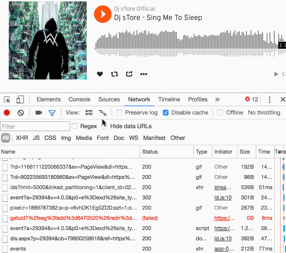

[SoundCloud](https://soundcloud.com/), for those who don't know it, is a great website that allows musicians to collaborate, promote and distribute their music.

Unfortunately it doesn't allow songs to be downloaded, but by using Google Chrome's [developer tools](https://support.google.com/dfp_premium/answer/4497389?hl=en) it's very easy to bypass this restriction.

## Instructions

1. **Go to [SoundCloud](https://soundcloud.com/)** using Google Chrome, and open the page of the song you want to download.
1. **Open the [developer tools](https://support.google.com/dfp_premium/answer/4497389?hl=en)** by pressing `F12` on Windows or `cmd` + `opt` + `I` on Mac. Click on the Network tab. In this section, click on the sixth icon from the left. This will open the timeline of the various downloads the browser is making.
1. Now you're ready to intercept the `.mp3` file to download! **Start the song** in the browser. As soon as the song starts you'll see some downloads starting on the timeline, one line will surely catch your attention because it will be much longer than the others. This line represents the song in `.mp3` format.
1. **Select the song from the timeline**. To do that, just drag the mouse over a small piece of the line; I recommend picking a part where this line is isolated so you don't get the selection wrong.
1. Once you've selected the download in the timeline, the entry for your track will appear at the bottom. Right-click it and click on **"Open link in new tab"**.
1. That's it! Now you have your track in `.mp3`! Click on `File`->`Save as...` and **enjoy the song** wherever and whenever you want!

## Video tutorial
Do 6 steps seem too many? I assure you that once you get the hang of it you can download whatever you want in less than 2 seconds. Here are the 6 steps wrapped up in a short video.

See you next time!
