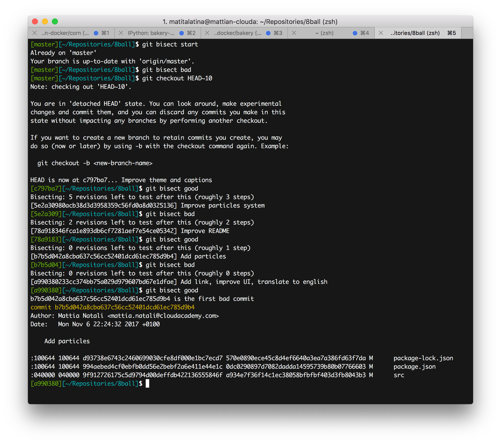

You added a feature to the software and it went to production. After a few weeks the Product Owner tells you it no longer works. Don't panic. Using only [Git](https://en.wikipedia.org/wiki/Git_(software)) you can fix everything in a few minutes!

**Anyone can run into a [software regression](https://en.wikipedia.org/wiki/Software_regression)** and it's never pleasant. I've seen many developers who, in a case like this, start trying to reproduce the bug locally and furiously re-read the code hoping to fix the bug. If many hands work on the code, **finding the bug can be anything but simple**.

Using this naive approach **we're not exploiting all the information we have**: we *are certain* that the feature *used to* work correctly. So something happened in the meantime that surely broke our part of the code. So why look for this change manually when Git can do the dirty work for us in very few steps? **Git can tell us precisely *what* happened, *when*, *who* did it and *why*** (if the developer who introduced the bug wrote a decent commit message).

## git bisect

Well yes, Git offers exactly this feature. Not everyone takes advantage of it but in cases like this it's extremely powerful. It's the **[`git bisect`](https://git-scm.com/docs/git-bisect)** command.

To cut a long story short, you define two commits: the first is a "buggy" commit, that is, one that presents the problem, the second is a healthy commit, where the problem didn't exist yet. Git then shows a commit that's in the middle and it's up to us to tell Git whether it works or not. Git at this point shows another commit that's always in the middle between the buggy commit and the healthy one. You keep going like this until Git shows us the commit that introduced the bug.

It seems like a very long process but it isn't: in fact, with each check we halve the number of commits between the good one and the buggy one. For example, if we have 1000 commits separating our two reference commits, we find the one that introduced the problem in log_2(1000) ~ 10 steps!

## Practical example

As an example I used a [small project of mine](http://8ball.mattianatali.it) that I had created to learn some concepts about [React](https://reactjs.org/). Let's suppose we want to know who added the particle effect to the page.
During the `git bisect` procedure we label as `bad` every time the project has the `src/components/atoms/ParticlesBackground` folder. While all the commits that don't have it will be `good`.


Let's start! First we clone the project and enter it with the terminal.

```
git clone https://github.com/matitalatina/8ball
cd 8ball
```

Now we start the search

```
git bisect start
```

Starting the program we notice that the `master` branch has the `src/components/atoms/ParticlesBackground` folder. So we label the commit as `bad`.

```
git bisect bad
```

Then we go back in Git's history far enough to no longer find the folder in question. In our case going back 10 commits is enough.

```
git checkout HEAD~10
```

Ok! Now the folder is gone! So we can label it as `good`.

```
git bisect good
```

Now Git will change commit and move exactly to a point halfway between the commits labeled as `good` and `bad`. It notifies you with the following message.

```
Bisecting: 5 revisions left to test after this (roughly 3 steps)
[5e2a30980acb38d3d3958359c56fd0a8d0325136] Improve particles system
```

Keep typing `git bisect good` or `git bisect bad` until you've analyzed about 4 steps.

In our specific case it will be:

```
git bisect bad
git bisect good
git bisect bad
git bisect good
```

Finally, when Git has identified the commit we were looking for, it tells you like this:

```
b7b5d042a8cba637c56cc52401dcd61ec785d9b4 is the first bad commit
commit b7b5d042a8cba637c56cc52401dcd61ec785d9b4
Author: Mattia Natali <***@***.***>
Date:   Mon Nov 6 22:24:32 2017 +0100

    Add particles

:100644 100644 d93738e6743c2460699030cfe8df000e1bc7ecd7 570e0890ece45c8d4ef6640a3ea7a386fd63f7da M	package-lock.json
:100644 100644 994aebed4cf0ebfb0dd56e2bebf2a6e411e44e1c 0dc0290897d7082dadda14595739b80b07766603 M	package.json
:040000 040000 9f912726175c5d9794d00deffdb422136555846f a934e7f36f14c1ec38058bfbfbf403d3fb8043b3 M	src
```



The commit message alone gives us the intuition that Git hit the bullseye ("Add particles")! But we don't trust it, so let's actually see what was done in this commit: take the commit id (`b7b5d042a8cba637c56cc52401dcd61ec785d9b4`) and type:

```
git show b7b5d042a8cba637c56cc52401dcd61ec785d9b4
```

scrolling through the commit we notice the part

```
diff --git a/src/components/atoms/ParticlesBackground/index.js b/src/components/atoms/ParticlesBackground/index.js
new file mode 100644
index 0000000..748f50d
--- /dev/null
+++ b/src/components/atoms/ParticlesBackground/index.js
@@ -0,0 +1,129 @@
+import Particles from 'react-particles-js'
+import styled from 'styled-components'
+import React from 'react'
+
+const Wrapper = styled.div`
+  pointer-events: none;
+  position: fixed;
+  top: 0;
+  bottom: 0;
+  left: 0;
+  right: 0;
+...
+```

which is exactly the part we were looking for! So ultimately now we know that Mattia Natali added this part on Monday, November 6, 2017 at 22:24.


## Conclusions

Imagine now doing this for a bug that's driving you crazy; it's very powerful because it tells you exactly who did it and what was changed. This way you can ask the commit author for clarification and know exactly the change that created the bug.

Maybe you won't need `git bisect` every day, but it's right to keep it in mind because it's certain that **sooner or later it will come in handy** and it will save you a lot of time.

See you next time!
